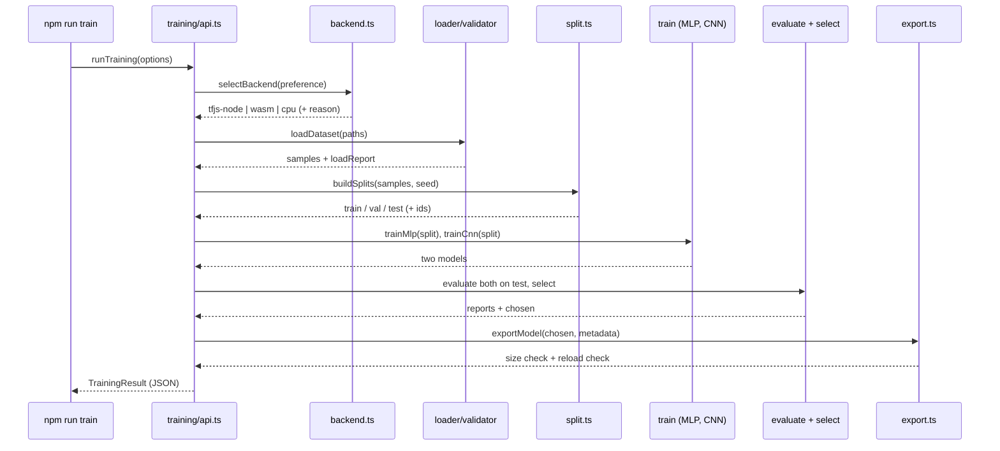
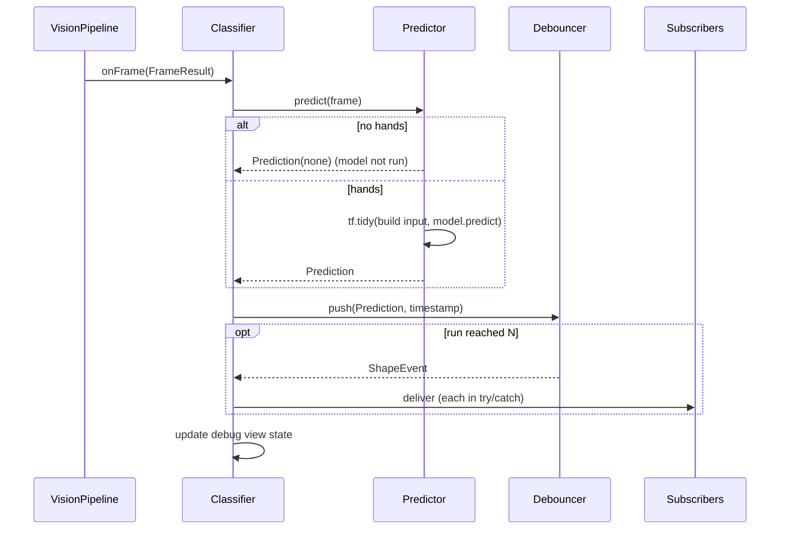

# Design Document

## Overview

This design adds the hand-shadow classifier to Needalaata. It has an offline half (`training/`, Node + TypeScript + TensorFlow.js) and a runtime half (`src/classifier/`, browser). Both halves import the same `FeatureExtractor` and mask codec from `src/vision/`, so training input equals live input and there is no train/serve skew.

The offline half loads the Spec 1 export files from the gitignored `data/raw/`, validates them, builds leak-free splits (test = whole contributors, validation = whole bursts), trains a Landmark MLP and a depthwise-separable Silhouette CNN, evaluates both on the held-out contributors, picks the better one, and exports it to `public/models/classifier/` with a metadata file. The runtime half loads that export, classifies each `FrameResult`, debounces the stream, and emits `{label, confidence, timestamp}` events through `onShape(...)`. A debug overlay (key C) shows the live prediction and recent events.

### Key design decisions

- **One language, one implementation.** Training runs in TypeScript on Node. It imports `src/vision/feature-extractor.ts` and the `encodeMask`/`decodeMask` codec directly. A Python pipeline would force a second implementation of the slot rule, Hand_Scale normalization, and mask decoding, and any drift would silently lower live accuracy. Spec 1's fast-check Properties 1 to 12 then protect both training and serving.
- **Move, do not copy.** `FeatureExtractor` and `MaskGenerator` move from `tools/collect/` to `src/vision/`. The mask codec (`encodeMask`, `decodeMask`) and the pure crop helpers have no top-level DOM access, so Node can import them. Only `createMaskGenerator().generate()` needs a canvas, and training never calls it because it uses the stored masks.
- **Backend is a runtime decision, not an install-time assumption.** `@tensorflow/tfjs-node` is preferred but optional, verified with a smoke operation, and followed by `wasm` then `cpu` fallbacks (see Research Findings). Model export uses one custom writer so the files are identical for every backend.
- **Reproducibility by construction.** All randomness comes from a seeded PRNG (`mulberry32`) owned by the pipeline and from seeded TensorFlow.js initializers. TensorFlow.js `fit({shuffle: true})` is not used, because its shuffle is not seedable through a documented option. The pipeline shuffles itself and calls `fit` one epoch at a time with `shuffle: false`.
- **Pure logic is separated from TensorFlow.** Splitting, metrics, selection, backend choice, debouncing, label encoding, and feature-vector building are pure functions, so they are property-tested cheaply. TensorFlow.js calls sit behind thin adapters.
- **Library first, CLI second.** Every npm script is a thin wrapper over a function exported from `training/api.ts`, so a future Shadow Lab MCP server can call the same functions.

### Deviations from steering docs (flagged)

- `structure.md` lists `src/ml/` and `training/` as notebook/scripts. This spec uses `src/classifier/` for the runtime (as requested) and `training/` for TypeScript scripts. Task 1.3 updates `structure.md` so the docs match.
- `tech.md` says every tunable number lives in `src/config.ts`. Runtime numbers (Stable_Frame_Count, Confidence_Threshold, log length, inference budget, model paths) do. Offline training hyperparameters live in the single `training/training-config.ts`, because they run only in Node and must not be bundled into the browser build. The spec requirement is "one training config".
- `.gitignore` currently ignores all of `public/models/`. Task 1.4 un-ignores `public/models/classifier/` (and keeps `hand_landmarker.task` ignored) and adds `data/raw/`.
- `tech.md` says "transfer learning on MobileNet". This spec trains a small MobileNet-style CNN from scratch (depthwise-separable blocks), as requested, because the input is a 96x96 single-channel mask and a pretrained RGB MobileNet would add megabytes and a network download. The design keeps the option open in Future Work.

## Research Findings

All TensorFlow.js APIs below were checked against the TensorFlow.js docs through Context7 (`/websites/js_tensorflow_api`, `/tensorflow/tfjs`) and, where noted, executed locally on this machine (macOS arm64, Node v26.13.0) in a throwaway directory.

| Topic | Finding | Source / verification |
|---|---|---|
| Layers | `tf.layers.separableConv2d` (depthwise then pointwise, options `depthMultiplier`, `depthwiseInitializer`, `pointwiseInitializer`) and `tf.layers.depthwiseConv2d` exist. | [TF.js API](https://js.tensorflow.org/api/latest); local run built a `separableConv2d` model on the CPU backend |
| Seeding | `tf.initializers.glorotUniform({seed})` takes a seed; `tf.layers.dropout({rate, seed})` accepts a seed. Two models built with the same seeds had identical weights. | API docs; local run |
| Save/load | `model.save(handlerOrURL)` and `tf.loadLayersModel(pathOrIOHandler)`. `file://` URLs need `tfjs-node`; on pure-JS backends the error is "Cannot find any save handlers". `tf.io.withSaveHandler(fn)` captures `modelTopology`, `weightSpecs`, `weightData`, and `tf.io.fromMemory(artifacts)` reloads them. A tiny model round-tripped with identical predictions. | local run |
| Memory | `tf.tidy(fn)` disposes intermediates except returned tensors. `tf.memory().numTensors` gives the live tensor count. | API docs |
| Early stopping | `tf.callbacks.earlyStopping` exists but `restoreBestWeights: true` is documented as not supported. The pipeline implements early stopping itself and snapshots the best weights. | API docs |
| WASM backend | `import '@tensorflow/tfjs-backend-wasm'` then `tf.setBackend('wasm')` works under Node 26 without extra setup. | [tfjs-backend-wasm README](https://github.com/tensorflow/tfjs/blob/master/tfjs-backend-wasm/README.md); local run |
| tfjs-node on Apple Silicon | Historically failed to install on arm64 ([issue 4514](https://github.com/tensorflow/tfjs/issues/4514)). `@tensorflow/tfjs-node@4.22.0` now installs on this machine (npm blocks the package's install script until it is approved or `npm rebuild @tensorflow/tfjs-node` is run). **However**, with Node v26.13.0 the native module loads (`tf.getBackend()` reports `tensorflow`) but the first kernel call throws `util_1.isNullOrUndefined is not a function`, because that function was removed from recent Node versions. | local install and run |
| Latest versions | `@tensorflow/tfjs` and `@tensorflow/tfjs-node` and `@tensorflow/tfjs-backend-wasm` are all 4.22.0 (latest). | `npm view` |

**Consequences.** (1) "Installs" is not "works", so the backend selector runs a smoke operation (`tf.ones([2]).sum()`) after loading. (2) On this machine today the selector will land on `wasm`. (3) Running training on Node 22 LTS should allow `tfjs-node`; this was not verified here. A `.nvmrc` is not added, because it would be an untested claim. (4) All three TensorFlow.js packages are pinned to exactly 4.22.0 so they share one `tfjs-core` singleton.

Content from web sources was summarized, not quoted.

## Architecture

```mermaid
flowchart TB
    subgraph Shared["src/vision/ (shared, no DOM at import)"]
        FE[feature-extractor.ts]
        MG[mask-generator.ts<br/>encodeMask / decodeMask / generate]
        TY[types.ts: LABELS, Sample, FrameResult]
    end

    subgraph Collect["tools/collect/ (unchanged behaviour)"]
        CAP[capture-controller] --> FE
        CAP --> MG
        EXP[exporter.ts SCHEMA_VERSION]
    end

    subgraph Train["training/ (Node + TS + TF.js)"]
        LOAD[dataset/loader + validator] --> FV[classifier/feature-vector]
        LOAD --> MG
        LOAD --> FE
        LOAD --> REP[dataset/report]
        LOAD --> SPL[split.ts]
        SPL --> AUG[augment.ts train only]
        AUG --> MLP[models/mlp.ts]
        AUG --> CNN[models/cnn.ts]
        MLP --> EVAL[evaluate.ts + metrics.ts]
        CNN --> EVAL
        EVAL --> SEL[select.ts]
        SEL --> EXPM[export.ts -> public/models/classifier/]
        BE[backend.ts] -.-> MLP
        BE -.-> CNN
        API[api.ts] --- LOAD
        API --- REP
        API --- SPL
        API --- EVAL
        CLI[cli: train / evaluate / dataset:report] --> API
        TC[training-config.ts] -.-> Train
    end

    subgraph Runtime["src/classifier/ (browser)"]
        PIPE[VisionPipeline.onFrame] --> PRED[predictor.ts]
        PRED --> FV
        PRED --> FE
        PRED --> MG
        PRED --> DEB[debouncer.ts]
        DEB --> EVT[onShape subscribers]
        PRED --> DBG[debug-view.ts key C]
        DEB --> DBG
    end

    EXPM -->|model.json, weights, metadata.json| PRED
    EXP --> LOAD
    CFG[src/config.ts] -.-> Runtime
```

### Module boundaries

- `src/vision/` still knows nothing about classifiers, puppets, or story.
- `src/classifier/` depends on `src/vision/` (types, extractor, mask generator) and `src/config.ts`. It emits Shape_Events and knows nothing about the story. The later `story/` spec subscribes with `onShape`.
- `training/` depends on `src/vision/`, `src/classifier/` (labels, feature vector, metadata types) and `tools/collect/exporter.ts` (for `SCHEMA_VERSION` and export types). It is never bundled into the browser build.
- Pure shared helpers (`labels.ts`, `feature-vector.ts`, `metadata.ts`) live in `src/classifier/` and import no TensorFlow.js, so training and runtime share them without pulling TF.js into pure tests.

### Training flow



### Runtime flow



## Components and Interfaces

### 1. Shared code relocation (`src/vision/`)

Move with `smart_relocate` so imports update automatically:

| From | To |
|---|---|
| `tools/collect/feature-extractor.ts` (+ `.test.ts`) | `src/vision/feature-extractor.ts` (+ `.test.ts`) |
| `tools/collect/mask-generator.ts` (+ `.test.ts`) | `src/vision/mask-generator.ts` (+ `.test.ts`) |

Rules for the move:

- No behavior change. Existing assertions in tests are not edited, only import paths.
- `tools/collect/types.ts` stays as the collector's re-export of `src/vision/types`.
- `feature-extractor.ts` and the codec/crop helpers in `mask-generator.ts` must not touch `document`, `window`, or `btoa`-less environments at import time. `btoa`/`atob` are global in Node 16+. `createCanvas` is only called inside `createMaskGenerator().generate()`.
- `src/vision/index.ts` re-exports the extractor and mask APIs for convenience.
- A new Node-environment test imports both modules and calls `extractFeatures`, `encodeMask`, `decodeMask` (Requirement 1.9).
- A structure test asserts that the two old file paths no longer exist (Requirement 1.6).

### 2. Shared pure helpers (`src/classifier/`, no TF.js import)

```ts
// src/classifier/labels.ts
import { LABELS, type Label } from '../vision/types';
export const LABEL_COUNT = 7;
export function labelToIndex(label: Label): number;          // rabbit=0 ... none=6
export function indexToLabel(index: number): Label;          // throws RangeError outside 0..6
export { LABELS };
```

```ts
// src/classifier/feature-vector.ts
import type { ExtractedFeatures } from '../vision/types';
export const LANDMARK_VALUES_PER_SLOT = 63;   // 21 x 3
export const FEATURE_VECTOR_LENGTH = 131;     // 2*63 + 2 flags + 3 offset
export function buildFeatureVector(f: ExtractedFeatures): Float32Array;
// layout: [slot0 normalized x,y,z * 21][slot1 normalized x,y,z * 21][present0, present1][offset x, y, z]
```

```ts
// src/classifier/mask-input.ts
export function maskToFloat(mask: Uint8Array): Float32Array; // byte / 255, length 9216
```

```ts
// src/classifier/metadata.ts
export type InputType = 'MLP' | 'CNN';
export interface ModelMetadata {
  labels: Label[];              // must equal LABELS
  inputType: InputType;
  inputShape: number[];         // [131] or [96, 96, 1]
  schemaVersion: string;        // exporter SCHEMA_VERSION used for training data
  trainedAt: string;            // ISO date
  testAccuracy: number;         // 0..1
}
export function parseModelMetadata(json: unknown): ModelMetadata; // throws MetadataError with a named reason
export function serializeModelMetadata(m: ModelMetadata): string;
```

`parseModelMetadata` rejects a label list that differs from `LABELS`, an unknown input type, an input shape that does not match the input type, and a non-finite accuracy (Requirement 9.9).

### 3. Training config (`training/training-config.ts`)

One module, one exported object, all numbers named:

```ts
export interface TrainingConfig {
  seed: number;                          // Split_Seed and model seed base
  paths: { rawDir: 'data/raw'; reportDir: 'training/out'; exportDir: 'public/models/classifier' };
  dataset: {
    minSamplesPerLabel: 250;
    maxContributorShare: 0.5;
    rebuildTolerance: number;            // |rebuilt - stored normalized| warn threshold
  };
  split: {
    testContributorFraction: number;     // fraction of contributors, at least 1 contributor
    validationBurstFraction: number;     // fraction of non-test bursts per label, at least 1 when label has >= 2 bursts
  };
  augmentation: {
    mlp: { landmarkJitter: number; scaleJitter: number; rotationDegrees: number; copies: number };
    cnn: { maxShiftPx: number; maxScale: number; copies: number };
  };
  mlp: { hidden: number[]; dropout: number; learningRate: number; epochs: number; batchSize: number; patience: number };
  cnn: { filters: number[]; strides: number[]; dropout: number; learningRate: number; epochs: number; batchSize: number; patience: number };
  evaluation: { accuracyTarget: 0.9; tieMarginPoints: 1; topConfusedPairs: number };
  export: { maxBytes: 5_242_880; reloadTolerance: number };
}
```

Defaults (starting points, tuned later from the report): MLP hidden `[128, 64]`, dropout 0.3; CNN filters `[8, 16, 32, 32]` with strides `[2, 2, 2, 1]`, dropout 0.3; Adam; early-stopping patience 8 on validation loss.

### 4. Backend selection (`training/backend.ts`)

```ts
export type BackendName = 'tfjs-node' | 'wasm' | 'cpu';
export interface BackendProbe { name: BackendName; available(): Promise<{ ok: boolean; reason?: string }>; }
export interface BackendChoice { backend: BackendName; fallbackReasons: Partial<Record<BackendName, string>>; }

// Pure selection over injected probes (property-testable).
export function chooseBackend(
  results: Record<BackendName, { ok: boolean; reason?: string }>,
  requested?: BackendName,
): BackendChoice;                 // throws BackendUnavailableError if requested is not ok, or none are ok

// Real probes: dynamic import + tf.setBackend + tf.ready + smoke op.
export function createProbes(): BackendProbe[];
export async function initBackend(requested?: BackendName, logger?: Logger): Promise<BackendChoice>;
```

- Order: `tfjs-node`, `wasm`, `cpu`.
- `tfjs-node` probe: dynamic `import('@tensorflow/tfjs-node')` inside try/catch, then `tf.setBackend('tensorflow')`, `tf.ready()`, then `tf.tidy(() => tf.ones([2]).sum().dataSync())`. Any throw marks it unavailable with the error text, so the Node 26 `isNullOrUndefined` failure falls back cleanly.
- `wasm` probe: `import('@tensorflow/tfjs-backend-wasm')`, `tf.setBackend('wasm')`, same smoke op.
- `cpu` probe: `tf.setBackend('cpu')`.
- `TRAIN_BACKEND` env var or `--backend` flag sets `requested`.
- `@tensorflow/tfjs-node` is an `optionalDependency`, so a failed native install does not break `npm install`.

### 5. Dataset loading and validation (`training/dataset/`)

```ts
export interface LoadOptions { rawDir?: string; files?: string[]; }
export interface LoadReport {
  filesRead: string[];
  filesRejected: { file: string; reason: string }[];
  samplesAccepted: number;
  samplesSkipped: { id: string | null; file: string; reason: string }[];
  duplicates: { id: string; file: string }[];
  warnings: { id: string; reason: string }[];       // rebuild tolerance mismatches
}
export interface ClassifierSample {
  id: string; label: Label; contributor: string; burstId: string; sessionId: string;
  featureVector: Float32Array;        // rebuilt via shared extractor
  mask: Uint8Array;                   // stored, decoded via production decodeMask
  hands: FrameResult['hands'];        // kept so MLP augmentation can re-extract
  frameWidth: number; frameHeight: number;
}
export async function loadDataset(opts: LoadOptions): Promise<{ samples: ClassifierSample[]; report: LoadReport }>;

// Pure, per-file, never throws:
export function validateExportDocument(doc: unknown, fileName: string): { samples: ClassifierSample[]; report: LoadReport };
```

Validation steps per file: JSON parse (catch), metadata presence, `schemaVersion === SCHEMA_VERSION` imported from `tools/collect/exporter.ts`, `labels` deep-equal `LABELS`, `maskSize` 96x96. Per sample: label in `LABELS`, slots length 2 with 21 landmarks each, finite numbers, non-empty `burstId` and `contributor`, `decodeMask` succeeds. A try/catch wraps each sample so one bad sample is recorded and skipped. Duplicate ids keep the first.

**Rebuilding features.** Each stored sample is converted back to a `FrameResult` (`hands` = the present slots' `rawLandmarks`, handedness, score; `frameWidth`/`frameHeight` from the sample) and passed to the shared `extractFeatures`, then `buildFeatureVector`. Slot order is recomputed by the same rule, so the vector equals what the runtime produces. The stored `normalizedLandmarks` are compared with the rebuilt ones; a difference over `rebuildTolerance` adds a warning, and the rebuilt values win.

### 6. Dataset report and contributor IDs (`training/dataset/report.ts`)

```ts
export type ContributorMap = Map<string, string>; // name -> 'C1'...
export function assignContributorIds(names: Iterable<string>): ContributorMap; // sorted ascending, C1..Cn
export interface DatasetReport {
  totals: { samples: number; bursts: number; contributors: number };
  perLabel: Record<Label, { samples: number; bursts: number }>;
  perContributor: Record<string, Record<Label, number>>;   // keys are C1, C2...
  warnings: string[];                                       // low count, dominant contributor, missing test labels
  split?: SplitSummary;                                     // seed, contributor ids per split, counts
  load: LoadReport;
}
export function buildDatasetReport(samples: ClassifierSample[], load: LoadReport, cfg: TrainingConfig['dataset'], split?: SplitResult): DatasetReport;
export function formatDatasetReport(r: DatasetReport): string; // readable text
```

Names are never copied into the report. IDs are stable for a given set of names (sorted order), but adding a new contributor whose name sorts earlier renumbers later IDs; this is stated in the report header so IDs are not compared across different datasets.

### 7. Leak-free splitting (`training/split.ts`)

```ts
export interface SplitResult {
  train: string[]; validation: string[]; test: string[];       // sample ids
  testContributors: string[]; validationContributors: string[]; trainContributors: string[]; // anonymised or raw names kept internal
  seed: number;
  warnings: string[];
}
export function buildSplits(
  samples: ReadonlyArray<Pick<ClassifierSample, 'id' | 'label' | 'contributor' | 'burstId'>>,
  cfg: TrainingConfig['split'],
  seed: number,
): SplitResult;     // throws InsufficientContributorsError if < 2 contributors
```

Algorithm (deterministic, independent of input order):

1. Sort contributors ascending, then shuffle with `mulberry32(seed)`. Take `max(1, round(testContributorFraction * n))` contributors as test, but always leave at least one contributor for train/validation. All their samples go to test.
2. For the remaining samples, group by `(label, burstId)`. Sort bursts per label by `burstId`, shuffle with the same PRNG stream, and take `max(1, round(validationBurstFraction * count))` bursts per label as validation when the label has at least two bursts; labels with one burst keep it in train.
3. Every other sample is train.
4. A burst belongs to one contributor in practice. If a `burstId` appears under two contributors (corrupt data), the burst key includes the contributor so it still lands in one split per contributor, and the validator records a warning.
5. Warn if a label has no test samples.

Sorting before shuffling makes the result a function of the set of samples and the seed, not of their order. No individual sample is ever assigned independently.

### 8. Augmentation (`training/augment.ts`)

Applied to the Train_Split only, by the dataset builder, and never called for validation or test.

- MLP: jitter raw landmarks, scale about the wrist, rotate in-plane by a small angle, then re-run the shared `extractFeatures` so augmented vectors stay on-distribution.
- CNN: random integer shift and small scale of the 96x96 mask with nearest-neighbour sampling, zero padded.
- Randomness comes from the seeded PRNG only.

### 9. Models (`training/models/`)

```ts
// mlp.ts
export function buildMlp(cfg: TrainingConfig['mlp'], seed: number): tf.LayersModel;
// Input [131] -> Dense(128, relu) -> Dropout -> Dense(64, relu) -> Dropout -> Dense(7, softmax)

// cnn.ts
export function buildCnn(cfg: TrainingConfig['cnn'], seed: number): tf.LayersModel;
// Input [96,96,1]
// Conv2D(8, 3x3, stride 2, same, relu)                        -> 48x48x8
// separableConv2D(16, 3x3, stride 2, same, relu) + BN         -> 24x24x16
// separableConv2D(32, 3x3, stride 2, same, relu) + BN         -> 12x12x32
// separableConv2D(32, 3x3, stride 1, same, relu) + BN         -> 12x12x32
// GlobalAveragePooling2D -> Dropout -> Dense(7, softmax)
```

Each layer gets explicit `kernelInitializer`/`depthwiseInitializer`/`pointwiseInitializer` as `tf.initializers.glorotUniform({seed: seed + layerIndex})` and each dropout gets `seed`. Batch normalization (`tf.layers.batchNormalization`) is used in the CNN. The CNN has roughly 5k parameters (under 100 KB as float32).

**Training loop (`training/train.ts`).**

```ts
export interface TrainResult { model: tf.LayersModel; history: EpochLog[]; bestEpoch: number; }
export async function trainModel(model, data: { train: Batch; validation: Batch }, cfg, seed, logger): Promise<TrainResult>;
```

Per epoch: shuffle train indices with the seeded PRNG, build tensors inside `tf.tidy`, call `model.fit(xs, ys, { epochs: 1, batchSize, shuffle: false })`, then `model.evaluate` on validation. Keep a cloned snapshot of the best weights (`model.getWeights()` cloned); stop after `patience` epochs without validation-loss improvement; finally `setWeights` from the snapshot and dispose the snapshot and data tensors. Loss is `categoricalCrossentropy`, metric accuracy. The test split is never passed to this function.

### 10. Evaluation, metrics, and selection

```ts
// training/metrics.ts (pure)
export interface Prediction { id: string; trueLabel: Label; predicted: Label; confidence: number; }
export interface EvaluationReport {
  model: 'MLP' | 'CNN';
  testSamples: number;
  accuracy: number;                                  // trace / total
  perLabel: Record<Label, { support: number; precision: number | null; recall: number | null }>;
  confusionMatrix: number[][];                       // 7x7, rows true, columns predicted, Label order
  misclassified: Prediction[];
  mostConfusedPairs: { true: Label; predicted: Label; count: number }[];   // off-diagonal, descending
  targetMet: boolean;
  exportBytes?: number;
  inferenceMsPerSample?: number;
}
export function evaluatePredictions(model: 'MLP' | 'CNN', preds: Prediction[], cfg: TrainingConfig['evaluation']): EvaluationReport;
export function formatEvaluationReport(r: EvaluationReport): string;

// training/select.ts (pure)
export function selectModel(a: EvaluationReport, b: EvaluationReport, tieMarginPoints: number): { chosen: 'MLP' | 'CNN'; reason: string };
```

`precision`/`recall` are `null` (rendered as `n/a`) when the denominator is zero, so no NaN reaches JSON. Selection: if `|accA - accB| * 100 > tieMarginPoints`, higher accuracy wins; otherwise smaller `exportBytes` wins, then lower `inferenceMsPerSample`, then MLP. When neither reaches `accuracyTarget`, `targetMet` is false, the readable summary says so, and the top confused pairs are listed; the pipeline still exports the selected model, marks `targetMet: false` in the result, and prints a warning.

`evaluateModel(model, testBatch)` is a thin TF.js adapter: it runs `model.predict` inside `tf.tidy`, takes `argMax` and max probability, and builds `Prediction[]`.

### 11. Export (`training/export.ts`)

```ts
export async function exportModel(model: tf.LayersModel, meta: ModelMetadata, dir: string, cfg: TrainingConfig['export']): Promise<ExportResult>;
```

Steps: `model.save(tf.io.withSaveHandler(async (artifacts) => { ...capture...; return { modelArtifactsInfo: {...} }; }))`, then write `model.json` and `weights.bin` ourselves, plus `metadata.json`. `model.json` contains `modelTopology`, `format`, `generatedBy`, `convertedBy`, and `weightsManifest: [{ paths: ['weights.bin'], weights: weightSpecs }]`, which is the layers-model layout that `tf.loadLayersModel(url)` reads. Because one writer is used for every backend, the layout is identical (Requirement 7.6). After writing: sum file sizes and fail above `maxBytes`; reload the written files through a small file `IOHandler` (`load()` returns the artifacts read from disk) with `tf.loadLayersModel`, predict on up to 32 test samples, and compare with the in-memory model within `reloadTolerance`.

`ExportResult` holds the file list, byte total, and reload max difference.

### 12. Training API and CLI (`training/api.ts`, `training/cli/*.ts`)

```ts
export interface Logger { info(msg: string): void; warn(msg: string): void; error(msg: string): void; }

export async function getDatasetStats(opts: LoadOptions & { config?: TrainingConfig }): Promise<DatasetReport>;
export function makeSplits(samples, config, seed?): SplitResult;
export async function trainCandidate(kind: 'MLP' | 'CNN', data: PreparedData, config, logger?): Promise<TrainedCandidate>;
export async function evaluateCandidate(c: TrainedCandidate, data: PreparedData, config): Promise<EvaluationReport>;
export function getConfusionMatrix(r: EvaluationReport): number[][];
export function getMisclassified(r: EvaluationReport): Prediction[];
export async function runTraining(opts?: RunOptions): Promise<TrainingResult>;   // end to end
export async function runEvaluation(opts?: RunOptions): Promise<EvaluationReport[]>; // reload exported model and score it
```

All return plain JSON-serializable objects (no `undefined`, NaN, Map, or typed arrays in results). The API never calls `process.exit` and logs only through the injected `Logger`. The CLI files parse flags, call the API, print `format*` output, write JSON to `training/out/`, and set `process.exitCode`.

npm scripts (dev dependency `tsx`, pinned, is used to run TypeScript with the repo's extensionless imports; reason noted for the commit message):

```json
{
  "scripts": {
    "dataset:report": "tsx training/cli/dataset-report.ts",
    "train": "tsx training/cli/train.ts",
    "evaluate": "tsx training/cli/evaluate.ts"
  }
}
```

`training/out/` is gitignored (reports can contain sample ids but no names or landmarks).

### 13. Runtime predictor (`src/classifier/predictor.ts`)

```ts
export interface Prediction {
  probabilities: number[];         // length 7, Label order, sums to ~1
  top: Label;
  confidence: number;              // probabilities[labelToIndex(top)]
  modelRan: boolean;
}
export interface Predictor {
  predict(frame: FrameResult): Prediction;      // synchronous
  dispose(): void;
}
export function createPredictor(model: LayersModelLike, meta: ModelMetadata, deps?: { maskGenerator?: MaskGenerator }): Predictor;
```

- `hands.length === 0` returns `{ top: 'none', confidence: 1, probabilities: oneHot(none), modelRan: false }` without touching the model.
- `inputType === 'MLP'`: `extractFeatures(frame)` then `buildFeatureVector`. `inputType === 'CNN'`: `extractFeatures(frame)` then `maskGenerator.generate(frame, slots)` then `maskToFloat`.
- Inference: `tf.tidy(() => { const x = tf.tensor(data, [1, ...shape]); const y = model.predict(x) as tf.Tensor; return y.dataSync() ... })`. The result is read as a plain array inside the tidy, so nothing escapes and the live tensor count is unchanged after the call (Requirement 9.5).
- Inference time per call is measured with `performance.now()` and kept for the debug view.
- Browser TF.js import is isolated in `src/classifier/tf.ts` (`import * as tf from '@tensorflow/tfjs'`, which registers the WebGL and CPU backends; the app calls `tf.setBackend('webgl')` and falls back to `'cpu'` if it fails). `predictor.ts` receives the model through a small `LayersModelLike` interface so tests can use a fixture.

### 14. Debouncer (`src/classifier/debouncer.ts`)

Pure state machine, no TF.js.

```ts
export interface ShapeEvent { label: Label; confidence: number; timestamp: number; }
export interface DebouncerOptions { stableFrames: number; confidenceThreshold: number; }
export interface Debouncer {
  push(top: Label, confidence: number, timestamp: number): ShapeEvent | null;
  reset(): void;
  readonly state: { label: Label | null; length: number; fired: boolean };
}
export function createDebouncer(opts: DebouncerOptions): Debouncer;
```

Rules, applied per frame:

1. If `top === 'none'` or `confidence < confidenceThreshold`: reset to `{label: null, length: 0, fired: false}`, return null.
2. Else if `top === state.label`: `length += 1`.
3. Else: start a new run `{label: top, length: 1, fired: false}`.
4. If `length >= stableFrames` and not `fired`: set `fired = true`, return `{label: top, confidence, timestamp}`.
5. Otherwise return null.

So a label fires exactly when its run length first reaches N, never again within that run, and can fire again only after the run is broken by `none`, a low-confidence frame, or a different label.

### 15. Classifier facade (`src/classifier/classifier.ts`)

```ts
export type ClassifierState = { status: 'loading' } | { status: 'ready' } | { status: 'error'; message: string };
export interface Classifier {
  onShape(subscriber: (e: ShapeEvent) => void): () => void;
  onPrediction(subscriber: (p: Prediction, frame: FrameResult) => void): () => void;
  getState(): ClassifierState;
  stop(): void;
}
export async function startClassifier(pipeline: VisionPipeline, deps?: ClassifierDeps): Promise<Classifier>;
```

- `startClassifier` fetches `config.classifier.metadataPath`, validates with `parseModelMetadata`, loads the model with `tf.loadLayersModel(config.classifier.modelPath)`, and runs one warm-up prediction on zeros inside `tf.tidy`.
- Any failure (network, parse, label mismatch, load) resolves the facade in the error state with a clear message; it never throws and the camera preview keeps running (Requirements 9.8, 9.9).
- `pipeline.onFrame` handler: `try { predict; debouncer.push; deliver } catch (e) { recordError; skip }` (Requirement 9.10).
- Delivery loops over a snapshot of subscribers; each call is wrapped in try/catch so one throwing subscriber does not block others (Requirement 10.11). `onShape` and `onPrediction` return unsubscribe functions, matching `onFrame`.
- `stop()` calls the pipeline unsubscribe, clears subscribers, and disposes the model.

### 16. Config additions (`src/config.ts`)

```ts
classifier: {
  modelPath: '/models/classifier/model.json',
  metadataPath: '/models/classifier/metadata.json',
  stableFrames: 24,               // ~0.8 s at 30 fps (tech.md)
  confidenceThreshold: 0.85,      // tech.md
  inferenceBudgetMs: 15,          // tech.md
  eventLogSize: 5,
  debugOverlay: { corner: 'tl' }  // font and color come from fpsOverlayStyle
}
```

`Config` gets a `classifier` section; the existing keys are unchanged.

### 17. Debug view (`src/classifier/debug-view.ts`)

```ts
export interface ClassifierDebugView {
  update(p: Prediction | null, state: ClassifierState): void;  // called per frame
  logEvent(e: ShapeEvent): void;
  draw(): void;                                                // called after the silhouette is drawn
  toggle(): void; isVisible(): boolean; dispose(): void;
}
export function createClassifierDebugView(canvas: HTMLCanvasElement): ClassifierDebugView;
export function formatPrediction(p: Prediction): string;       // 'rabbit 0.93'
export function takeLastEvents(events: ShapeEvent[], k: number): ShapeEvent[]; // pure, most recent first
```

It mirrors `FpsOverlay`: starts hidden, toggles on `c`/`C` (ignoring key repeat, modifiers, and focus in `INPUT`/`TEXTAREA`/contentEditable), and draws text on the preview canvas with `config.fpsOverlayStyle.font` and `.color`. It is placed in `config.classifier.debugOverlay.corner` (default `tl`), which differs from the FPS corner (`tr`). It shows the top label and confidence, the last inference time in ms, and the last `eventLogSize` events; in the error state it shows the error message instead.

`src/main.ts` wiring: after `pipeline` creation, `startClassifier(pipeline)` runs without blocking `pipeline.start()`. The `onFrame` handler already draws the silhouette and FPS; `debugView.draw()` runs after `fps.update`. `onPrediction` feeds `debugView.update`, and `onShape` feeds `debugView.logEvent`.

## Data Models

### Export document (from Spec 1, unchanged)

`ExportDocument { metadata: ExportMetadata; samples: Sample[] }` with `schemaVersion` `'1.0.0'`, `labels`, `maskSize`, and per-sample `rawLandmarks`, `normalizedLandmarks`, `interHand`, `maskBase64`, `frameWidth`, `frameHeight`, `sessionId`, `burstId`, `contributor`, `timestamp`. The classifier consumes it as is.

### Model inputs

| Model | Input | Source |
|---|---|---|
| Landmark MLP | `Float32Array(131)` | `buildFeatureVector(extractFeatures(frame))` |
| Silhouette CNN | `Float32Array(9216)` shaped `[96, 96, 1]` | `maskToFloat(mask)` where `mask` is the stored (training) or generated (runtime) 96x96 byte mask |

### Exported files in `public/models/classifier/`

```
model.json       # topology + weightsManifest (paths: ["weights.bin"])
weights.bin      # float32 weights
metadata.json    # ModelMetadata
```

Example `metadata.json`:

```json
{
  "labels": ["rabbit","lion","bird","snake","crocodile","demon","none"],
  "inputType": "MLP",
  "inputShape": [131],
  "schemaVersion": "1.0.0",
  "trainedAt": "2025-11-12T10:00:00.000Z",
  "testAccuracy": 0.93
}
```

### Reports

`DatasetReport` and `EvaluationReport` (see components 6 and 10) are written to `training/out/` as JSON and printed as readable text. Contributors appear only as `C1`, `C2`. Per-sample entries use sample ids only.

## Correctness Properties

*A property is a characteristic or behavior that should hold true across all valid executions of a system-essentially, a formal statement about what the system should do. Properties serve as the bridge between human-readable specifications and machine-verifiable correctness guarantees.*

Properties 1 to 8 are the properties required by Requirement 11. Properties 9 to 22 cover further pure logic (loading, reports, metrics, selection, backend choice, metadata, predictor, subscriptions, debug log). Property tests for 9 to 22 are marked optional in the task list.

Frame-sequence generators for the debouncer produce arrays of `{label, confidence}` over the seven Labels with confidences in `[0, 1]`, biased to produce long runs, exact-threshold values, and `none` frames. `stableFrames` is generated in `[2, 30]`.

### Property 1: No fire without a long enough run

*For any* frame sequence and `stableFrames` N, if the debouncer fires a Shape_Event at frame i, then the N frames ending at frame i all have the same non-`none` label and confidence at or above the Confidence_Threshold; consequently a sequence with no such window of N frames fires nothing.

**Validates: Requirements 10.2, 11.2**

### Property 2: Rapid alternation never fires

*For any* frame sequence in which no N consecutive frames share the same top label (for example, labels that change at least every N-1 frames), the debouncer fires no Shape_Event.

**Validates: Requirements 10.8, 11.3**

### Property 3: `none` and low-confidence frames reset the run

*For any* frame sequence and any position k where the frame is `none` or below the Confidence_Threshold, the frames before k contribute nothing to a run that includes frames after k: the first fire after k requires at least N qualifying same-label frames after k.

**Validates: Requirements 10.6, 10.7, 11.4**

### Property 4: Exactly one fire per unbroken stable run

*For any* frame sequence, each maximal run of consecutive qualifying frames of one label with length L produces exactly one event when L is at least N and none when L is below N, so the total number of events equals the number of such runs.

**Validates: Requirements 10.4, 10.5, 11.5**

### Property 5: Fired event matches its run

*For any* frame sequence, every fired event has the label of the run that produced it, the confidence of the frame that completed the first N frames of that run, and that frame's timestamp.

**Validates: Requirements 10.3, 11.6**

### Property 6: Splits are leak-free

*For any* generated dataset with at least two contributors, `buildSplits` assigns every sample to exactly one of train, validation, or test; at least one whole contributor is in test; no contributor has samples in both train and test; and no burst has samples in more than one split. Every label with at least two non-test bursts has a validation sample.

**Validates: Requirements 4.1, 4.2, 4.3, 4.4, 4.9, 11.7**

### Property 7: Splits are deterministic and order-independent

*For any* generated dataset and seed, building splits twice, and building splits from a shuffled copy of the sample array, produce identical train, validation, and test id sets.

**Validates: Requirements 4.5**

### Property 8: Label encoding round trip

*For any* of the seven Labels, `indexToLabel(labelToIndex(label))` equals the label, `labelToIndex` is a bijection onto `0..6`, and the order matches `rabbit, lion, bird, snake, crocodile, demon, none`.

**Validates: Requirements 11.8**

### Property 9: Feature vector layout is fixed

*For any* frame with zero, one, or two hands, `buildFeatureVector(extractFeatures(frame))` has length 131, contains only finite numbers, equals the concatenation of slot 0 normalized values, slot 1 normalized values, the two Presence_Flags (1 or 0), and the inter-hand offset, and has all-zero values for an absent slot.

**Validates: Requirements 5.1, 5.2**

### Property 10: Validation partitions every sample and never throws

*For any* export document whose samples are randomly corrupted (unknown label, wrong landmark count, non-finite coordinate, bad base64 or wrong mask length, missing burst or contributor, duplicate id), `validateExportDocument` does not throw, and the number of accepted samples plus the number of skipped samples plus the number of duplicates equals the input sample count; every skipped entry has a non-empty reason; every accepted sample is valid.

**Validates: Requirements 2.6, 2.7, 2.8, 2.12**

### Property 11: Rebuilt features equal live features

*For any* generated frame, extracting features live, writing them into a Sample through the Spec 1 exporter, parsing the exported JSON, and rebuilding the Feature_Vector from the stored raw landmarks and frame size gives a vector equal (within epsilon) to the live Feature_Vector, and the stored mask decodes to the original mask bytes.

**Validates: Requirements 2.9, 2.10, 8.10**

### Property 12: Dataset report counts are consistent

*For any* generated dataset, the per-label sample counts sum to the total sample count, each per-contributor row sums to that contributor's sample count, per-label burst counts equal the number of distinct burst ids for that label, and low-count and dominant-contributor warnings appear exactly for the labels whose count is below the minimum or whose largest contributor share exceeds the maximum.

**Validates: Requirements 3.1, 3.2, 3.5, 3.6**

### Property 13: Contributor IDs are stable and anonymising

*For any* set of contributor names, `assignContributorIds` returns `C1..Cn` as a bijection, returns the same mapping for any ordering of the input, and the JSON of a dataset report built from samples with those names contains none of the names.

**Validates: Requirements 3.3, 3.4**

### Property 14: Confusion matrix and metrics are consistent

*For any* list of predictions, the confusion matrix is 7x7 with entries summing to the number of predictions, row sums equal the true-label counts, accuracy equals trace divided by total, the misclassified list has length total minus trace with every entry's true label different from its predicted label, precision and recall are `null` exactly when their denominator is zero, the most-confused pairs are off-diagonal and sorted by descending count, and `JSON.parse(JSON.stringify(report))` equals the report.

**Validates: Requirements 6.1, 6.2, 6.3, 6.7, 6.8, 8.9**

### Property 15: Model selection follows the rule

*For any* two evaluation reports, the model with accuracy more than the tie margin higher is chosen; otherwise the one with fewer exported bytes is chosen, then lower inference time, then MLP.

**Validates: Requirements 6.5, 6.6**

### Property 16: Backend choice follows preference order

*For any* availability of `tfjs-node`, `wasm`, and `cpu`, `chooseBackend` returns the first available backend in that order and records a reason for each skipped backend; when a backend is requested and unavailable, or none is available, it throws.

**Validates: Requirements 8.2, 8.3, 8.4, 8.5**

### Property 17: Model metadata round trip

*For any* valid metadata object, `parseModelMetadata(JSON.parse(serializeModelMetadata(m)))` equals `m`; and for any metadata whose label list differs from the application's Label order, parsing fails with a mismatch error.

**Validates: Requirements 7.2, 9.9**

### Property 18: No hands means `none` without running the model

*For any* frame with no hands (any timestamp and frame size), the predictor returns top label `none`, and a spy on the model records zero predict calls.

**Validates: Requirements 9.4**

### Property 19: Predictions are distributions and leak no tensors

*For any* sequence of generated frames and a fixture model of each input type, every prediction has 7 non-negative probabilities summing to 1 within tolerance, its top label is the argmax, and the live tensor count after each frame equals the count before.

**Validates: Requirements 9.3, 9.5**

### Property 20: Subscriptions behave like a set

*For any* sequence of subscribe, unsubscribe, and emit operations, each emitted event is delivered exactly to the subscribers that are subscribed at that moment, an unsubscribed subscriber never receives later events, and a throwing subscriber does not stop delivery to the others.

**Validates: Requirements 10.9, 10.10, 10.11**

### Property 21: Debug event log keeps the most recent events

*For any* list of events and log size K, `takeLastEvents` returns the min(K, length) most recent events in most-recent-first order.

**Validates: Requirements 12.4**

## Error Handling

| Situation | Behavior |
|---|---|
| Export file unreadable or invalid JSON | Recorded in `filesRejected`; other files continue (Req 2.5) |
| Schema version, label list, or mask size mismatch | File rejected with found vs expected values (Req 2.2 to 2.4) |
| Bad sample (label, landmarks, mask, ids) | Sample skipped with reason; run continues (Req 2.7) |
| No valid samples | `NoValidSamplesError` with the load report; CLI exits non-zero (Req 2.13) |
| Fewer than two contributors | `InsufficientContributorsError` before any training (Req 4.7) |
| Label missing from test | Warning in the report (Req 4.8) |
| Accuracy target missed | Report says so and lists most-confused pairs; export still happens; no crash (Req 6.7) |
| Zero-support label | Precision/recall `null` (`n/a`), never NaN (Req 6.8) |
| `tfjs-node` missing, broken, or failing the smoke op | Fallback to `wasm`, then `cpu`, with the reason logged (Req 8.3, 8.4) |
| Requested backend unavailable | `BackendUnavailableError` (Req 8.5) |
| Export larger than 5 MB or reload mismatch | `ExportError`; files are removed or marked invalid so a bad model is not shipped (Req 7.3, 7.4) |
| Runtime model or metadata fails to load, or labels mismatch | Classifier state `error` with message; preview keeps running; debug view shows the message (Req 9.8, 9.9, 12.7) |
| Predictor throws on one frame | Frame skipped, error recorded, next frame processed (Req 9.10) |
| Subscriber throws | Caught per subscriber; others still receive the event (Req 10.11) |
| WebGL backend unavailable in browser | Falls back to the TF.js CPU backend; the debug view shows inference time so a slow fallback is visible |

## Testing Strategy

Property-based testing applies: the debouncer, splitter, label codec, feature vector, validation, metrics, selection, backend choice, and metadata are pure functions with large input spaces. TensorFlow.js training, file output, and DOM overlay code are tested with example and integration tests instead.

### Property-based tests

- Library: **fast-check** (already a dev dependency, 4.10.2). No hand-rolled property testing.
- Each property is one fast-check test with at least 100 runs (`{ numRuns: 100 }` or higher).
- Each test carries the tag comment `// Feature: classifier, Property {number}: {property_text}`, the same format as Spec 1.
- Test files sit next to the code: `src/classifier/debouncer.test.ts` (Properties 1 to 5), `training/split.test.ts` (6, 7), `src/classifier/labels.test.ts` (8), `src/classifier/feature-vector.test.ts` (9), `training/dataset/validator.test.ts` (10, 11), `training/dataset/report.test.ts` (12, 13), `training/metrics.test.ts` and `training/select.test.ts` (14, 15), `training/backend.test.ts` (16), `src/classifier/metadata.test.ts` (17), `src/classifier/predictor.test.ts` (18, 19), `src/classifier/classifier.test.ts` (20), `src/classifier/debug-view.test.ts` (21).
- Properties 19 uses a tiny fixture model built with TF.js on the CPU backend in the vitest Node environment. Property 18 uses a spy object for the model.

### Unit and example tests

- Relocation: Node-environment import test of the extractor and codec (Req 1.9); old paths do not exist (Req 1.6); full Spec 1 suite passes unchanged (Req 1.8).
- Loader: temp directory with valid file, wrong-version file, garbage file, and a non-JSON file (Req 2.1 to 2.5); empty folder error (Req 2.13); `.gitignore` contains `data/raw/` (Req 2.14).
- Rebuild tolerance warning with tampered normalized landmarks (Req 2.11).
- Split: one-contributor error (Req 4.7); missing-label-in-test warning (Req 4.8); spy test that augmentation runs on train only (Req 4.10).
- Models: MLP input shape `[131]`, CNN input `[96,96,1]`, CNN contains `separableConv2d`, output 7-way softmax (Req 5.1, 5.3).
- Training: tiny synthetic dataset, a few epochs, CPU backend; two runs with the same seed give equal initial weights and equal final weights within tolerance (Req 5.6); `tf.memory().numTensors` unchanged apart from model weights (Req 5.8); `fit` receives only train and validation data (Req 5.7).
- Export: tiny model saved with the custom writer, files present, size under limit, reload predictions match (Req 7.1 to 7.4); `git check-ignore` shows `public/models/classifier/` is tracked (Req 7.5).
- Backend: a cpu-versus-wasm forward-pass comparison on a fixed tiny model within tolerance, skipped with a logged reason if wasm is unavailable (Req 8.6).
- Config and scripts: `package.json` has `train`, `evaluate`, `dataset:report` (Req 8.7); `Config` defines `stableFrames`, `confidenceThreshold`, and distinct overlay corners (Req 10.1, 12.8).
- Facade: failing loader gives error state without throwing (Req 9.8); throwing predictor skips a frame (Req 9.10); `stop()` unsubscribes and disposes (Req 9.11).
- Debug view: hidden by default, C toggles, ignores C in inputs, uses FPS font/color, shows error message (Req 12.1, 12.2, 12.5 to 12.7).

### Integration and manual checks

- Performance smoke (Req 9.6, 9.7): with a real exported model, the debug view shows inference ms under the 15 ms budget and the FPS overlay stays at 30 or higher; recorded in `KIRO_LOG.md`. This cannot be asserted in CI.
- End-to-end training on real `data/raw/` exports depends on the data collected in Spec 1; the training pipeline is verified with synthetic data until real files exist.

### What is not covered by automation

Live accuracy on new people and the 90 percent target depend on collected data. The evaluation report is the evidence; the tests only prove that the report is computed correctly.

## Future Work (not in scope)

- A Shadow Lab MCP server that wraps `training/api.ts`.
- Optional transfer learning from a pretrained MobileNet if the from-scratch CNN underperforms.
- Redesigning a shadow when the report names a confused pair, as `product.md` advises.
