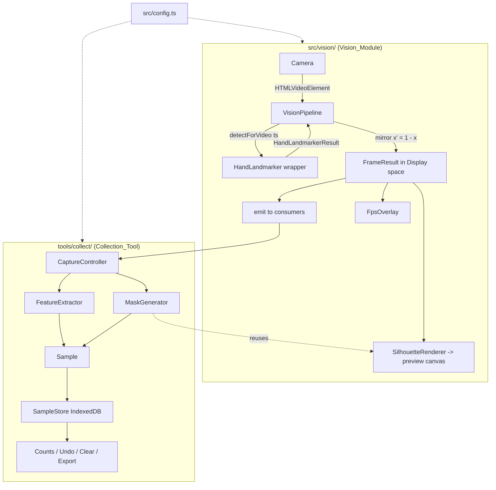
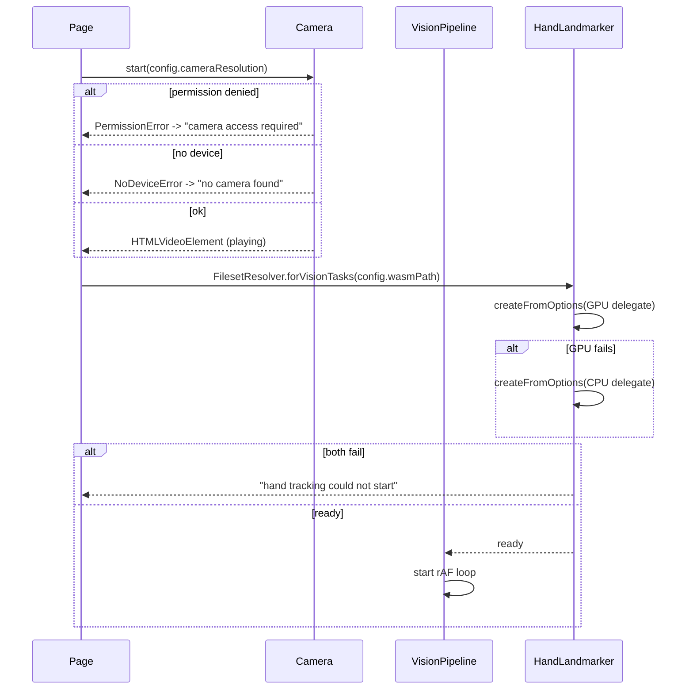

# Design Document

## Overview

This design covers the **vision module** (`src/vision/`) and the **collection tool** (`tools/collect/`) for Needalaata. The vision module owns webcam capture, MediaPipe HandLandmarker inference, per-frame landmark emission in the mirrored Display_Coordinate_Space, and the warm, soft Shadow_Silhouette preview. The collection tool reuses the vision module to record labeled Samples (raw + normalized landmarks, inter-hand features, and a 96x96 shadow mask) for the seven classifier labels, with reference illustrations, a countdown, configurable-rate burst recording, live counts, IndexedDB persistence, and versioned JSON export.

All processing stays on-device. No webcam frames leave the browser. Every tunable number lives in `src/config.ts` (Req 17). The vision module knows nothing about puppets or game flow (Req 1.3).

### Key design decisions (traceable)

- **Single mirroring.** Landmarks are mirrored exactly once, in the `VisionPipeline`, as `x' = 1 - x`. Every consumer (renderer, feature extractor, stored Samples) receives already-mirrored Display_Coordinate_Space values. The `SilhouetteRenderer` draws those mirrored landmarks directly and applies **no** additional canvas flip. Only the `<video>` element is visually flipped, via CSS `transform: scaleX(-1)`; the preview canvas is **not** flipped. This guarantees the silhouette aligns with the user's perceived motion while keeping one coordinate space for emitted and stored data (Req 4.1, 4.2, 5.5, 5.6).
- **Aspect-corrected feature space.** MediaPipe returns normalized `[0,1]` coordinates that distort distances on a non-square frame. Before computing `Hand_Scale`, `Normalized_Landmarks`, and the inter-hand wrist offset, landmarks are converted to aspect-corrected pixel space (`xc = x * frameWidth`, `yc = y * frameHeight`, `zc = z * frameWidth`). Raw landmarks are stored as the MediaPipe-normalized **display-space** values (the mirrored `[0,1]` values), **not** aspect-corrected, so features can be recomputed later from raw data plus the stored frame dimensions (Req 11.3, 11.4, 11.7).
- **Scale-relative silhouette.** Stroke thickness and mask padding are multiples of each hand's `Hand_Scale` in pixels, not fixed pixel counts, so silhouettes look consistent regardless of the user's distance from the camera (Req 6.3, 12.2).
- **Asset setup script.** A `scripts/setup-assets.mjs` step, wired to npm `postinstall`, copies the vision WASM fileset into `public/wasm` and downloads `hand_landmarker.task` into `public/models`. This keeps all MediaPipe assets served from the application's own origin — never a CDN (Req 3.1, 3.2, 3.3).
- **Confirmed API only.** The module uses only the confirmed `@mediapipe/tasks-vision` HandLandmarker API: `FilesetResolver.forVisionTasks`, `HandLandmarker.createFromOptions`, and `handLandmarker.detectForVideo(video, timestampMs)`.

### Asset setup (README note)

Running `npm install` triggers `postinstall` → `node scripts/setup-assets.mjs`, which:

1. Copies `node_modules/@mediapipe/tasks-vision/wasm` → `public/wasm`.
2. Downloads `hand_landmarker.task` into `public/models/` only if it is missing.

This must be documented in the README so judges and contributors get working local assets on a fresh clone. The config paths `wasmPath: "/wasm"` and `modelAssetPath: "/models/hand_landmarker.task"` stay consistent with the script's output.

## Architecture



### Module boundaries

- `src/vision/` emits `FrameResult`s and renders the preview. It contains no puppet or game-flow logic (Req 1.3).
- `tools/collect/` imports the vision module and layers capture, feature extraction, mask generation, persistence, and export on top. It never duplicates camera or HandLandmarker logic (Req 1.5).

### Multi-page Vite build

The collector is a separate page (Req 1.4). `vite.config.ts` declares two Rollup inputs so both the main app and the collector build as independent HTML entry points:

```ts
// vite.config.ts (sketch)
import { defineConfig } from "vite";
import { resolve } from "node:path";

export default defineConfig({
  build: {
    rollupOptions: {
      input: {
        main: resolve(__dirname, "index.html"),
        collect: resolve(__dirname, "tools/collect/index.html"),
      },
    },
  },
});
```

`package.json` wires the asset setup:

```json
{
  "scripts": {
    "postinstall": "node scripts/setup-assets.mjs"
  }
}
```

### Initialization sequence



## Components and Interfaces

### Config (`src/config.ts`)

All tunables live here; the vision module and collection tool read from Config rather than inlining literals (Req 17.4).

```ts
export interface Config {
  // Camera + silhouette appearance (Req 17.1)
  cameraResolution: { width: number; height: number };
  silhouetteBlurRadius: number;          // px, applied on downscaled offscreen canvas
  backgroundColor: string;               // near-black
  warmSilhouetteColor: string;           // warm lamp-lit color
  strokeThicknessScale: number;          // UNITLESS multiplier of Hand_Scale (px) (Req 6.3, 17.1)
  silhouetteDownscale: number;           // offscreen render scale, default 0.5 (Req 6.4)

  // Timings + rates (Req 17.2)
  countdownDurationMs: number;
  burstDurationMs: number;
  captureRatePerSecond: number;          // default 10 (Req 17.2)
  uiRefreshIntervalMs: number;
  fpsOverlayStyle: { font: string; color: string; corner: "tl" | "tr" | "bl" | "br" };

  // Mask (Req 17.3)
  maskSize: { width: 96; height: 96 };   // fixed 96x96
  maskPaddingScale: number;              // UNITLESS multiplier of Hand_Scale (px) (Req 12.2, 17.3)

  // Asset paths (served from own origin, Req 3.1-3.3)
  wasmPath: string;                      // "/wasm"
  modelAssetPath: string;                // "/models/hand_landmarker.task"
}
```

Example values:

```ts
export const config: Config = {
  cameraResolution: { width: 1280, height: 720 },
  silhouetteBlurRadius: 12,
  backgroundColor: "#0a0a0c",
  warmSilhouetteColor: "#ffb36b",
  strokeThicknessScale: 0.25,   // 25% of a hand's wrist->MCP distance
  silhouetteDownscale: 0.5,
  countdownDurationMs: 3000,
  burstDurationMs: 4000,
  captureRatePerSecond: 10,
  uiRefreshIntervalMs: 250,
  fpsOverlayStyle: { font: "12px monospace", color: "#8f8", corner: "tr" },
  maskSize: { width: 96, height: 96 },
  maskPaddingScale: 0.6,        // padding = 0.6 * handScalePx
  wasmPath: "/wasm",
  modelAssetPath: "/models/hand_landmarker.task",
};
```

### Camera (`src/vision/camera.ts`)

```ts
export interface Camera {
  start(resolution: { width: number; height: number }): Promise<HTMLVideoElement>;
  stop(): void;
}
```

- Requests `getUserMedia` at `config.cameraResolution` (Req 2.1) and attaches the stream to a `<video>` that begins playback (Req 2.2).
- On permission denial, surfaces a "camera access is required" message and halts startup (Req 2.3). On no device, surfaces "no camera was found" (Req 2.4).
- The `<video>` element is visually mirrored with CSS `transform: scaleX(-1)` (Req 4.1). The preview canvas is **not** flipped — mirroring of drawn content happens once in the pipeline (`x' = 1 - x`), so the renderer draws already-mirrored landmarks with no extra canvas flip (Req 4.2).
- The page shows an on-device processing notice (Req 2.5).

### HandLandmarker wrapper (`src/vision/hand-landmarker.ts`)

```ts
export interface HandTracker {
  init(): Promise<void>;                          // GPU then CPU fallback
  detect(video: HTMLVideoElement, timestampMs: number): HandLandmarkerResult;
  isReady(): boolean;
}
```

- `init()` resolves the WASM fileset from `config.wasmPath` (own origin) before creating the instance (Req 3.1), then calls `HandLandmarker.createFromOptions` with `modelAssetPath = config.modelAssetPath`, `numHands = 2`, `runningMode = "VIDEO"` (Req 3.2). No CDN is used (Req 3.3).
- Creation attempts the GPU delegate first (Req 3.4); on failure it retries with the CPU delegate (Req 3.5); if both fail it surfaces "hand tracking could not start" (Req 3.6).

### VisionPipeline (`src/vision/pipeline.ts`)

```ts
export interface HandObservation {
  landmarks: Landmark[];        // 21 points, Display space (mirrored), [0,1]
  handedness: string;
  score: number;
}

export interface FrameResult {
  hands: HandObservation[];     // empty when no hands (Req 5.4)
  timestamp: number;            // SAME value passed to detectForVideo (Req 5.1)
  frameWidth: number;           // source frame px (for aspect correction + Sample)
  frameHeight: number;
}

export type FrameConsumer = (result: FrameResult) => void;

export interface VisionPipeline {
  onFrame(consumer: FrameConsumer): () => void;  // returns unsubscribe
  start(): void;
  stop(): void;
}
```

Per-frame loop (single timestamp, Req 5.1, 5.2, 7):

```ts
function tick() {
  const ts = performance.now();                 // ONE timestamp per tick (Req 5.1)
  if (video.currentTime !== lastVideoTime) {    // skip reprocessed frames (Req 5.2)
    lastVideoTime = video.currentTime;
    const result = tracker.detect(video, ts);   // detectForVideo(video, ts)
    const hands = result.landmarks.map((lm, i) => ({
      landmarks: lm.map(p => ({ x: 1 - p.x, y: p.y, z: p.z })), // single mirror (Req 5.5)
      handedness: result.handedness[i][0].categoryName,
      score: result.handedness[i][0].score,
    }));
    const frame: FrameResult = {
      hands, timestamp: ts,                      // SAME ts emitted (Req 5.1, 5.3)
      frameWidth: video.videoWidth,
      frameHeight: video.videoHeight,
    };
    emit(frame);                                 // to consumers (Req 5.3, 5.4)
    renderer.render(frame, { color: config.warmSilhouetteColor,
                             background: config.backgroundColor,
                             blurRadius: config.silhouetteBlurRadius });
    fpsOverlay.update(ts);
  }
  requestAnimationFrame(tick);
}
```

The Display_Coordinate_Space contract (mirrored `[0,1]`, origin top-left) is documented here and shared by consumers and stored Samples (Req 5.6).

### SilhouetteRenderer (`src/vision/silhouette-renderer.ts`)

```ts
export interface RenderOptions {
  color: string;
  background: string;
  blurRadius: number;
}

export interface SilhouetteRenderer {
  render(frame: FrameResult, options: RenderOptions): void;
  // returns the rendered surface so the MaskGenerator can reuse the exact geometry
  renderToCanvas(frame: FrameResult, options: RenderOptions): HTMLCanvasElement;
}
```

- Fills the target with `options.background` (Req 6.1). When no hands are present, only the background is drawn (Req 6.7).
- For each detected hand, builds the silhouette from thick rounded strokes along each finger's bones plus a filled palm polygon (Req 6.2). It draws the already-mirrored landmarks directly and applies **no** additional canvas flip (Req 4.2).
- Stroke width is **scale-relative**: `strokeWidth = config.strokeThicknessScale * handScalePx`, where `handScalePx` is the hand's `Hand_Scale` computed in aspect-corrected pixel space. This keeps finger shapes visibly consistent whether the hand is near or far from the camera (Req 6.3).
- **Blur performance (Req 6.4):** renders to an **offscreen** canvas scaled by `config.silhouetteDownscale` (default 0.5), then draws it back up to full size. Where supported it uses `ctx.filter = \`blur(${options.blurRadius}px)\``; when `ctx.filter` is unavailable, the downscale → upscale step provides the softening fallback. The silhouette is drawn in `options.color` (Req 6.5). No thin skeleton lines or joint dots are drawn (Req 6.6).

The preview call passes the warm color on the near-black background. The `MaskGenerator` passes the **same geometry** rendered **white on black** (see below), so both share one renderer (Req 12.1).

### FpsOverlay (`src/vision/fps-overlay.ts`)

- Starts hidden (Req 7.3); the D key toggles visibility (Req 7.2).
- While enabled, draws current FPS in a corner using `config.fpsOverlayStyle` (Req 7.1) and refreshes at `config.uiRefreshIntervalMs` (Req 7.4).

### FeatureExtractor (`tools/collect/feature-extractor.ts`)

```ts
export interface HandFeatures {
  rawLandmarks: Landmark[];        // 21x3, Display space (mirrored, [0,1]) — NOT aspect-corrected
  normalizedLandmarks: Landmark[]; // 21x3, wrist-relative / Hand_Scale, aspect-corrected space
  handedness: string;
  score: number;
  present: boolean;
}

export interface InterHandFeatures {
  wristOffset: { x: number; y: number; z: number }; // (slot1 wrist - slot0 wrist)/mean HandScale
  handCount: number;
}

export interface ExtractedFeatures {
  slots: [HandFeatures, HandFeatures]; // fixed length 2
  interHand: InterHandFeatures;
}
```

**Aspect correction (Req 11.4, 11.7).** Before computing anything, each landmark is lifted to aspect-corrected pixel space using the frame dimensions carried on `FrameResult`:

```
xc = x * frameWidth
yc = y * frameHeight
zc = z * frameWidth
```

- `Hand_Scale` = distance in aspect-corrected space from landmark 0 (wrist) to landmark 9 (middle-finger MCP).
- `Normalized_Landmarks` = aspect-corrected landmarks made wrist-relative (subtract aspect-corrected landmark 0) then divided by `Hand_Scale`.
- `Raw_Landmarks` are the **mirrored display-space** `[0,1]` values, stored unmodified (Req 11.3).

**Slot assignment (deterministic).** Slots are assigned by position/order, never by MediaPipe handedness (Req 11.2, 18.5):

1. Exactly one hand → that hand goes to Hand_Slot 0; Hand_Slot 1 is absent and zero-filled (Req 11.1, 18.8).
2. Two hands → compare wrist (landmark 0) x. Smaller x → Hand_Slot 0; larger x → Hand_Slot 1.
3. **Tiebreaker chain** for equal wrist x: order by wrist y (smaller first); if y is also equal, order by detection score (higher first). This yields a total order so assignment stays deterministic and order-independent even for identical wrist x (Req 11.2, revision to Property 2).

Absent slots are zero-filled across all 21x3 raw and normalized values with `present = false` (Req 11.6, 18.4). The inter-hand wrist offset uses the aspect-corrected wrists divided by the mean `Hand_Scale`; if either slot is absent it is zero-filled (Req 11.7, 11.8). `handCount` equals the number of present slots. The output slot array is always length 2, so the feature vector length is fixed regardless of hand count (Req 18.3).

### MaskGenerator (`tools/collect/mask-generator.ts`)

```ts
export interface MaskGenerator {
  generate(frame: FrameResult, slots: [HandFeatures, HandFeatures]): Uint8Array; // 96*96 bytes
}
```

- Renders the silhouette by calling the **same** `SilhouetteRenderer`, passing **white on black** options: `{ color: "#ffffff", background: "#000000", blurRadius: config.silhouetteBlurRadius }` (Req 12.1). The same geometry that drives the preview drives the mask.
- When hands are detected, crops to the bounding box of the detected hands plus `padding = config.maskPaddingScale * handScalePx` (scale-relative padding, consistent across camera distance) (Req 12.2).
- Centers the crop and resizes to 96x96 preserving aspect ratio; converts the white-on-black render to a **single-channel grayscale** buffer where `0 = background` and `255 = shadow` (Req 12.3).
- For label `none` with no hands detected, returns a blank mask (all `0`) (Req 12.4).

### CaptureController (`tools/collect/capture-controller.ts`)

- Owns the countdown (`config.countdownDurationMs`, Req 10.1), burst timing (`config.burstDurationMs`, Req 10.2), and capture rate (`config.captureRatePerSecond`, Req 10.3).
- On burst start, mints a new `Burst_ID` (Req 10.2); each captured Sample is labeled with the active Label (Req 10.3). On burst end, returns to the ready state (Req 10.4). Shows a recording-in-progress indicator while active (Req 10.5).
- Capture rate uses an accumulator so a steady `captureRatePerSecond` (default 10/s) is emitted independent of frame rate.
- Guards: recording is disabled until HandLandmarker is ready (Req 14.1, 14.2); recording is blocked with a prompt if the contributor name is empty (Req 9.3).

### SampleStore (`tools/collect/sample-store.ts`)

```ts
export interface SampleStore {
  put(sample: Sample): Promise<void>;
  all(): Promise<Sample[]>;
  countsByLabel(): Promise<Record<Label, number>>;
  deleteBurst(burstId: string): Promise<void>;
  undoLastBurst(): Promise<void>;
  clearAll(): Promise<void>;
}
```

- IndexedDB-backed (database `needalaata-collect`, object store `samples` keyed by `id`, indexes `by_burst` on `burstId` and `by_label` on `label`); persists each captured Sample (Req 15.1) and restores Samples + per-label counts on page load (Req 15.2).
- **Undo last burst (Req 15.3):** "most recent burst" is defined as the `burstId` of the Sample with the **latest `timestamp`**. `undoLastBurst()` scans all Samples for the max-timestamp Sample, reads its `burstId`, and deletes every Sample with that `burstId`. Defining it by stored timestamp (not in-memory state) means undo works correctly even after a page reload.
- Clear all requires a confirmation step (Req 15.4); on confirm, removes every Sample (Req 15.5).

### Collection UI (`tools/collect/ui.ts`)

- Label picker offering exactly `rabbit`, `lion`, `bird`, `snake`, `crocodile`, `demon`, `none` (Req 8.1); selecting one marks it active (Req 8.2).
- While a Label is active, shows its reference illustration and shadow description from the product shadow vocabulary (Req 8.3, 8.4).
- Free-text contributor name field (Req 9.1), stored with each Sample (Req 9.2).
- Per-label count display for all seven labels (Req 13.1), incremented on capture (Req 13.2), refreshed within `config.uiRefreshIntervalMs` (Req 13.3).
- Live 96x96 mask thumbnail of what will be captured, updated each frame while the preview runs (Req 14.3, 14.4).
- Export control (see Exporter).

### Exporter (`tools/collect/exporter.ts`)

- Serializes all Samples into one JSON document with a metadata header + sample list (Req 16.1).
- Metadata header includes schema version, Label list, mask size, normalization description, export date, and a `maskEncoding` description (Req 16.2).
- Each Sample carries id, label, two Hand_Slots (raw, normalized, handedness, score, presence), inter-hand features, mask, session id, burst id, contributor, timestamp, plus `frameWidth`/`frameHeight` (Req 16.3).
- Each mask is encoded as base64 (Req 16.4). Downloads a file whose name includes contributor name + export date (Req 16.5). If no Samples exist, blocks export and informs the contributor there is nothing to export (Req 16.6).

## Data Models

### Landmark

```ts
interface Landmark { x: number; y: number; z: number; }
```

In `FrameResult.hands[].landmarks` and in `Sample` raw landmarks, `x`/`y` are mirrored Display_Coordinate_Space values in `[0,1]`.

### HandSlot

```ts
interface HandSlot {
  present: boolean;                // Presence_Flag (Req 11.5, 11.6)
  handedness: string;              // MediaPipe label, stored but NOT used for slotting
  score: number;
  rawLandmarks: Landmark[];        // 21x3, mirrored display space [0,1] (Req 11.3)
  normalizedLandmarks: Landmark[]; // 21x3, aspect-corrected, wrist-relative / Hand_Scale (Req 11.4)
}
```

Absent slots: all 21x3 raw and normalized values are exactly zero and `present = false` (Req 11.6, 18.4).

### Sample

```ts
interface Sample {
  id: string;                      // UUID, IndexedDB keyPath
  label: Label;                    // one of the seven (Req 11.10)
  slots: [HandSlot, HandSlot];     // slot 0, slot 1 (Req 11.1, 11.2)
  interHand: {
    wristOffset: { x: number; y: number; z: number }; // aspect-corrected, /mean HandScale (Req 11.7)
    handCount: number;
  };
  maskBase64: string;              // see encoding below (Req 11.9)
  frameWidth: number;              // source frame px — lets features be recomputed later
  frameHeight: number;
  sessionId: string;               // unique per page load (Req 11.10)
  burstId: string;                 // unique per burst (Req 11.10)
  contributor: string;             // contributor name (Req 11.10)
  timestamp: number;               // capture time (Req 11.10)
}
```

`frameWidth`/`frameHeight` are stored so aspect-corrected features (`Hand_Scale`, normalized landmarks, inter-hand offset) can be recomputed from the raw display-space landmarks without re-recording.

**`maskBase64` encoding (Req 11.9, 16.4):** base64 of the raw 96x96 `Uint8` bytes in **row-major** order, where `0 = background` and `255 = shadow`. Length before encoding is exactly `96 * 96 = 9216` bytes.

### ExportMetadata

```ts
interface ExportMetadata {
  schemaVersion: string;
  labels: Label[];
  maskSize: { width: 96; height: 96 };
  normalization: string;  // describes aspect-corrected, wrist-relative, /Hand_Scale method
  maskEncoding: string;   // "base64 of row-major 96x96 uint8, 0=background 255=shadow"
  exportDate: string;
}

interface ExportDocument {
  metadata: ExportMetadata;
  samples: Sample[];
}
```

## Correctness Properties

*A property is a characteristic or behavior that should hold true across all valid executions of a system — essentially, a formal statement about what the system should do. Properties serve as the bridge between human-readable specifications and machine-verifiable correctness guarantees.*

Generators produce hands in mirrored display space `[0,1]` together with a `frameWidth`/`frameHeight`; translation and scale transforms in the invariance properties are applied in normalized space and then aspect-corrected consistently with the implementation, so the invariants described below hold under aspect correction.

### Property 1: Single-hand goes to slot 0

*For any* single detected hand placed anywhere in the frame, the built Sample stores that hand in Hand_Slot 0 (present) and leaves Hand_Slot 1 absent, regardless of frame position.

**Validates: Requirements 11.1, 18.8**

### Property 2: Two-hand slot assignment by wrist x with deterministic tiebreak

*For any* pair of detected hands, the hand whose wrist (landmark 0) has the smaller x is stored in Hand_Slot 0 and the other in Hand_Slot 1; when wrist x values are equal, the hand with the smaller wrist y goes to slot 0, and when wrist y is also equal, the hand with the higher detection score goes to slot 0 — yielding a deterministic assignment. Generators must include pairs with identical wrist x (and a sub-case with identical wrist x and y).

**Validates: Requirements 11.2**

### Property 3: Slot assignment is independent of detection order

*For any* pair of detected hands, building the Sample from the hand array `[a, b]` produces the same stored Sample as building it from `[b, a]`.

**Validates: Requirements 18.5**

### Property 4: Raw landmarks preserved in display space

*For any* present hand, the stored Raw_Landmarks equal the input mirrored display-space landmarks unchanged, as 21 three-dimensional points (not aspect-corrected).

**Validates: Requirements 11.3**

### Property 5: Normalized landmarks are translation invariant

*For any* detected hand and any translation applied in normalized space, the resulting aspect-corrected Normalized_Landmarks are equal (within epsilon) before and after translation.

**Validates: Requirements 18.1**

### Property 6: Normalized landmarks are scale invariant

*For any* detected hand and any positive uniform scale factor applied about the wrist in aspect-corrected space, the resulting Normalized_Landmarks are equal (within epsilon).

**Validates: Requirements 18.2**

### Property 7: Inter-hand features are translation and scale invariant

*For any* pair of detected hands, the inter-hand wrist offset is invariant (within epsilon) to a shared translation applied in normalized space and to a positive uniform scale applied about a common point in aspect-corrected space.

**Validates: Requirements 18.6, 18.7**

### Property 8: Absent slots store exactly zeros

*For any* Sample with an absent Hand_Slot, every one of that slot's 21x3 raw and 21x3 normalized values is exactly zero and its Presence_Flag is absent.

**Validates: Requirements 11.6, 18.4**

### Property 9: Fixed-length feature output regardless of hand count

*For any* frame with zero, one, or two detected hands, the extracted feature output has the same fixed structure: exactly two Hand_Slots and one inter-hand feature block.

**Validates: Requirements 18.3**

### Property 10: Inter-hand wrist offset zero-filled when a hand is missing

*For any* Sample where either Hand_Slot is absent, the inter-hand wrist offset is the zero vector and `handCount` equals the number of present slots.

**Validates: Requirements 11.7, 11.8**

### Property 11: Mask has fixed shape and byte-exact encoding round-trip

*For any* detected hand input, the generated Shadow_Mask is a 96x96 single-channel buffer, and base64-encoding then decoding `maskBase64` reproduces the original row-major bytes exactly (0 = background, 255 = shadow).

**Validates: Requirements 11.9, 12.3, 16.4**

### Property 12: Export round-trip preserves samples

*For any* set of recorded Samples, serializing to the export JSON and parsing it back reproduces equal Samples, including each mask decoded byte-for-byte from its base64 string.

**Validates: Requirements 16.1, 16.3, 16.4**

## Error Handling

- **Camera permission denied** → display "camera access is required" and stop the startup sequence (Req 2.3).
- **No camera device** → display "no camera was found" (Req 2.4).
- **HandLandmarker GPU failure** → silently retry with the CPU delegate (Req 3.5).
- **HandLandmarker GPU + CPU failure** → display "hand tracking could not start" (Req 3.6).
- **Missing/failed assets** → `scripts/setup-assets.mjs` ensures WASM and model files exist locally before runtime; if the model cannot be fetched at setup time the script exits non-zero so the developer notices early (supports Req 3.1–3.3).
- **Empty contributor name on record** → block recording and prompt for a name (Req 9.3).
- **Tracker not ready** → recording control disabled until ready (Req 14.1, 14.2).
- **Export with no Samples** → block export and inform the contributor there is nothing to export (Req 16.6).
- **Clear all** → require a confirmation step before deletion (Req 15.4).
- **IndexedDB unavailable or quota exceeded** → surface a non-fatal "samples could not be saved" message in the collector UI and keep the preview running (resilience around Req 15.1).
- **Frame reprocessing** → skip inference when `video.currentTime` is unchanged (Req 5.2).

## Testing Strategy

The feature-computation core (FeatureExtractor, MaskGenerator encoding, Exporter) is pure input→output logic with strong invariants, so it is a good fit for property-based testing. Rendering, DOM wiring, IndexedDB, and camera/HandLandmarker integration are verified with example-based and integration tests instead.

### Property-based tests

- Use a property-based testing library for TypeScript (**fast-check**). Do not hand-roll PBT.
- Each property test runs a **minimum of 100 iterations**.
- Each test is tagged with a comment: **Feature: vision-and-collection, Property {number}: {property_text}**.
- Implement each of Properties 1–12 with a single property-based test. Generators produce mirrored display-space hands with frame dimensions; invariance tests apply the transform in normalized space then aspect-correct consistently. Property 2's generator must include pairs with identical wrist x (and a sub-case with identical wrist x and y) to exercise the tiebreaker chain.

### Unit / example tests

- **Mirroring (single flip):** a landmark at mirrored `x = 0.2` renders on the **left** side of the preview canvas, and the `SilhouetteRenderer` applies no additional canvas flip (Req 4.2).
- Slot carries handedness, score, presence (Req 11.5).
- Label + contributor + session id + burst id + timestamp stored on capture (Req 11.10).
- MaskGenerator invokes the shared `SilhouetteRenderer` with white-on-black options (Req 12.1), and mask padding scales with `Hand_Scale` across two hands at different scales (Req 12.2).
- `none` label with no hands → blank mask (all bytes 0) (Req 12.4).
- Burst accumulator emits ~10 samples per simulated second at `config.captureRatePerSecond = 10` independent of frame rate (Req 10.3).
- Export filename includes contributor + date; "nothing to export" guard fires with zero Samples (Req 16.5, 16.6).
- Undo last burst deletes exactly the max-timestamp Sample's `burstId` group, verified after simulating a reload (empty in-memory state) (Req 15.3).

### Integration tests

- Camera startup paths (granted / denied / no device) surface the correct messages (Req 2.2–2.4).
- HandLandmarker init prefers GPU, falls back to CPU, and reports failure when both fail (Req 3.4–3.6).
- IndexedDB persistence survives a simulated page reload: counts and Samples restore (Req 15.1, 15.2).

### Performance tests

- Confirm the pipeline sustains the 30 fps target with the FPS overlay enabled. The `SilhouetteRenderer`'s offscreen downscale (`config.silhouetteDownscale`, default 0.5) keeps blur cost low; `detectForVideo` runs **synchronously on the UI thread**, so inference is gated to once per new frame via the `currentTime` guard. This is the primary cost to watch against the 30 fps / <15 ms-per-inference targets from `tech.md`.
