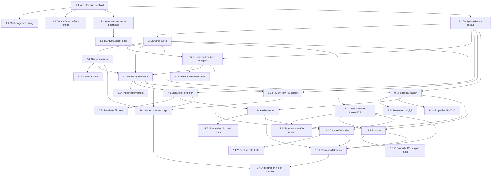

# Implementation Plan: Vision Module and Collection Tool

## Overview

This plan implements the `src/vision/` vision module and the `tools/collect/` collection tool in TypeScript (strict mode) with Vite, following the approved design. Work is ordered test-driven and incremental: scaffolding first, then centralized config and shared types, then the pure feature-computation core (property-tested with fast-check), then the I/O and rendering layers, then persistence and export, and finally UI wiring for both the collector page and the vision preview page. Each step builds on the prior ones with no orphaned code — every module is wired into a consumer by the time the plan completes.

The design has a full "Correctness Properties" section (Properties 1–12), so property-based test sub-tasks are included and placed close to the code they validate. Test sub-tasks are marked optional with `*`.

## Task Ordering Overview



## Tasks

- [ ] 1. Project scaffolding and asset setup
  - [x] 1.1 Initialize Vite + TypeScript strict project with folder structure
    - Create `package.json`, `tsconfig.json` with `"strict": true`, root `index.html`
    - Create directories `src/vision/`, `src/config.ts` placeholder, `tools/collect/`
    - Ensure the vision module folder contains no puppet/game-flow logic (structure boundary)
    - _Requirements: 1.1, 1.3, 1.6_

  - [ ] 1.2 Configure multi-page Vite build
    - Add `vite.config.ts` with Rollup inputs `main: index.html` and `collect: tools/collect/index.html`
    - Create a minimal `tools/collect/index.html` entry point
    - _Requirements: 1.4, Design "Multi-page Vite build"_

  - [ ] 1.3 Install dependencies and test tooling
    - Add `@mediapipe/tasks-vision` as the hand-tracking dependency
    - Add `vitest` and `fast-check` as dev dependencies; add a `test` script using `vitest --run`
    - _Requirements: 1.2, Design "Testing Strategy"_

  - [x] 1.4 Add asset setup script wired to postinstall
    - Create `scripts/setup-assets.mjs` that copies `node_modules/@mediapipe/tasks-vision/wasm` to `public/wasm` and downloads `hand_landmarker.task` into `public/models/` only if missing (exit non-zero on model fetch failure)
    - Wire `"postinstall": "node scripts/setup-assets.mjs"` in `package.json`
    - _Requirements: 3.1, 3.2, 3.3, Design "Asset setup script"_

  - [x] 1.5 Document asset setup in README
    - Describe that `npm install` triggers `postinstall` → copies WASM to `public/wasm` and downloads the model to `public/models`, keeping assets on the app's own origin
    - _Requirements: 3.1, 3.3, Design "Asset setup (README note)"_

- [x] 2. Centralized configuration
  - [x] 2.1 Implement Config interface and default config object
    - Define the `Config` interface in `src/config.ts`
    - Export a default `config` with `cameraResolution`, `silhouetteBlurRadius`, `backgroundColor`, `warmSilhouetteColor`, `strokeThicknessScale = 0.25`, `silhouetteDownscale = 0.5`, `countdownDurationMs`, `burstDurationMs`, `captureRatePerSecond = 10`, `uiRefreshIntervalMs`, `fpsOverlayStyle`, `maskSize = {96,96}`, `maskPaddingScale`, `wasmPath = "/wasm"`, `modelAssetPath = "/models/hand_landmarker.task"`
    - _Requirements: 17.1, 17.2, 17.3, 17.4_

- [x] 3. Shared types
  - [x] 3.1 Define shared data model types
    - Create `src/vision/types.ts` (and a collect types file as needed) with `Landmark`, `HandObservation`, `FrameResult` (including `frameWidth`/`frameHeight`), `HandSlot`, `Sample` (`id` as UUID), `InterHandFeatures`, `ExtractedFeatures`, `ExportMetadata`, `ExportDocument`, and the `Label` union (`rabbit | lion | bird | snake | crocodile | demon | none`)
    - Document the Display_Coordinate_Space contract (mirrored `[0,1]`, origin top-left)
    - _Requirements: 5.6, 11.1–11.10, 16.2, 16.3, 18.3, Design "Data Models"_

- [x] 4. Camera module
  - [x] 4.1 Implement camera capture and mirroring
    - Create `src/vision/camera.ts` with `start(resolution)`/`stop()`; request `getUserMedia` at `config.cameraResolution` and attach the stream to a playing `<video>`
    - Mirror the `<video>` visually with CSS `transform: scaleX(-1)` (the preview canvas is NOT flipped)
    - Surface "camera access is required" on permission denial and halt startup; surface "no camera was found" when no device exists; show the on-device processing notice
    - _Requirements: 2.1, 2.2, 2.3, 2.4, 2.5, 4.1_

  - [ ]* 4.2 Write camera startup tests
    - Test granted / denied / no-device paths surface the correct messages
    - _Requirements: 2.2, 2.3, 2.4_

- [x] 5. HandLandmarker wrapper
  - [x] 5.1 Implement HandLandmarker initialization with GPU/CPU fallback
    - Create `src/vision/hand-landmarker.ts`: resolve the WASM fileset from `config.wasmPath` via `FilesetResolver.forVisionTasks`, then `HandLandmarker.createFromOptions` with local `modelAssetPath`, `numHands = 2`, `runningMode = "VIDEO"`
    - Attempt the GPU delegate first, retry with CPU on failure, surface "hand tracking could not start" if both fail; expose `detect(video, ts)` and `isReady()`
    - _Requirements: 3.1, 3.2, 3.3, 3.4, 3.5, 3.6_

  - [ ]* 5.2 Write HandLandmarker init tests
    - Test GPU-preferred, CPU fallback, and both-fail reporting
    - _Requirements: 3.4, 3.5, 3.6_

- [x] 6. Vision pipeline
  - [x] 6.1 Implement VisionPipeline per-frame loop
    - Create `src/vision/pipeline.ts`: rAF loop computing ONE `performance.now()` timestamp per tick, passed to both `detectForVideo` and the emitted `FrameResult.timestamp`
    - Guard reprocessing via `video.currentTime` unchanged; apply the single mirror `x' = 1 - x`; emit `FrameResult` with `frameWidth`/`frameHeight`; emit empty hands when none detected; provide `onFrame` subscribe returning an unsubscribe
    - _Requirements: 5.1, 5.2, 5.3, 5.4, 5.5, 5.6_

  - [ ]* 6.2 Write mirroring and emission unit test
    - Verify a landmark mirrored to `x = 0.2` maps to the left of the preview and that the same timestamp is emitted as was passed to detect
    - _Requirements: 4.2, 5.1_

- [x] 7. Silhouette renderer
  - [x] 7.1 Implement SilhouetteRenderer
    - Create `src/vision/silhouette-renderer.ts` with `render(frame, options)` and `renderToCanvas(frame, options)` taking `RenderOptions {color, background, blurRadius}`
    - Fill background; build each hand from thick rounded finger-bone strokes plus a filled palm polygon; `strokeWidth = config.strokeThicknessScale * handScalePx`; draw already-mirrored landmarks with NO extra canvas flip; no skeleton lines or joint dots
    - Blur via offscreen canvas scaled by `config.silhouetteDownscale` using `ctx.filter = blur(...)` with downscale→upscale fallback when `ctx.filter` is unavailable; background-only when no hands
    - _Requirements: 6.1, 6.2, 6.3, 6.4, 6.5, 6.6, 6.7, 4.2_

  - [ ]* 7.2 Write renderer single-flip example test
    - Confirm a mirrored `x = 0.2` landmark renders on the left side and no additional canvas flip is applied
    - _Requirements: 4.2_

- [x] 8. FPS debug overlay
  - [x] 8.1 Implement FPS overlay with D-key toggle
    - Create `src/vision/fps-overlay.ts`: start hidden, toggle on the D key, draw current FPS in the configured corner/style, refresh at `config.uiRefreshIntervalMs`
    - _Requirements: 7.1, 7.2, 7.3, 7.4_

- [x] 9. Feature extraction core
  - [x] 9.1 Implement FeatureExtractor
    - Create `tools/collect/feature-extractor.ts`: aspect-correct landmarks (`xc = x*fw`, `yc = y*fh`, `zc = z*fw`); `Hand_Scale` = aspect-corrected distance from landmark 0 to landmark 9; normalized landmarks = wrist-relative / Hand_Scale; store raw landmarks as mirrored display-space `[0,1]`
    - Slot assignment: one hand → slot 0, slot 1 absent/zero-filled; two hands → smaller wrist.x → slot 0 with (y, then score) tiebreaker chain; inter-hand wrist offset = (slot1 − slot0 wrist)/mean Hand_Scale, zero-filled if a slot is absent; `handCount` = present slots; output always length-2 slots (fixed-length)
    - _Requirements: 11.1, 11.2, 11.3, 11.4, 11.5, 11.6, 11.7, 11.8, 18.3, 18.4, 18.5, 18.8_

  - [x] 9.2 Write property tests for slot assignment and raw/zero-fill invariants
    - **Property 1: Single-hand goes to slot 0** — Validates: Requirements 11.1, 18.8
    - **Property 2: Two-hand slot assignment by wrist x with deterministic tiebreak** (generators include identical wrist x, and identical wrist x+y) — Validates: Requirements 11.2
    - **Property 3: Slot assignment independent of detection order** — Validates: Requirements 18.5
    - **Property 4: Raw landmarks preserved in display space** — Validates: Requirements 11.3
    - **Property 8: Absent slots store exactly zeros** — Validates: Requirements 11.6, 18.4
    - **Property 9: Fixed-length feature output regardless of hand count** — Validates: Requirements 18.3
    - Use fast-check, ≥100 iterations each, tagged `// Feature: vision-and-collection, Property N: ...`
    - _Requirements: 11.1, 11.2, 11.3, 11.6, 18.3, 18.4, 18.5, 18.8_

  - [x] 9.3 Write property tests for normalization and inter-hand invariants
    - **Property 5: Normalized landmarks are translation invariant** — Validates: Requirements 18.1
    - **Property 6: Normalized landmarks are scale invariant** — Validates: Requirements 18.2
    - **Property 7: Inter-hand features translation and scale invariant** — Validates: Requirements 18.6, 18.7
    - **Property 10: Inter-hand wrist offset zero-filled when a hand is missing** — Validates: Requirements 11.7, 11.8
    - Use fast-check, ≥100 iterations each, tagged `// Feature: vision-and-collection, Property N: ...`
    - _Requirements: 18.1, 18.2, 18.6, 18.7, 11.7, 11.8_

- [x] 10. Checkpoint - core feature logic verified
  - Ensure all tests pass, ask the user if questions arise.

- [x] 11. Shadow mask generation
  - [x] 11.1 Implement MaskGenerator
    - Create `tools/collect/mask-generator.ts`: render the silhouette via the SAME `SilhouetteRenderer` with white-on-black options; crop to the detected-hands bounding box plus `padding = config.maskPaddingScale * handScalePx`; center and resize to 96x96 preserving aspect ratio; emit a single-channel grayscale `Uint8Array` (`0 = background`, `255 = shadow`)
    - Return a blank mask (all zeros) for label `none` with no hands; expose the same path for the live 96x96 thumbnail updated each frame
    - _Requirements: 12.1, 12.2, 12.3, 12.4, 14.3, 14.4_

  - [x] 11.2 Write mask tests and encoding property test
    - **Property 11: Mask has fixed shape and byte-exact encoding round-trip** — Validates: Requirements 11.9, 12.3, 16.4 (fast-check, ≥100 iterations, tagged comment)
    - Example tests: MaskGenerator invokes shared renderer with white-on-black (12.1); padding scales with Hand_Scale across two different-scale hands (12.2); `none` + no hands → all-zero mask (12.4)
    - _Requirements: 11.9, 12.1, 12.2, 12.3, 12.4, 16.4_

- [x] 12. Sample persistence
  - [x] 12.1 Implement SampleStore over IndexedDB
    - Create `tools/collect/sample-store.ts`: database `needalaata-collect`, store `samples` keyed by `id`, indexes `by_burst` and `by_label`
    - Implement `put`, `all`, `countsByLabel`, `deleteBurst`, `undoLastBurst` (delete all samples sharing the max-`timestamp` sample's `burstId`), `clearAll`; restore samples and counts on load; surface a non-fatal "samples could not be saved" on IndexedDB failure
    - _Requirements: 15.1, 15.2, 15.3, 15.5, 13.1_

  - [ ]* 12.2 Write persistence tests including undo-after-reload
    - Undo last burst deletes exactly the max-timestamp `burstId` group, verified after simulating a reload (empty in-memory state); counts and samples restore on load
    - _Requirements: 15.1, 15.2, 15.3_

- [x] 13. Versioned JSON export
  - [x] 13.1 Implement Exporter
    - Create `tools/collect/exporter.ts`: serialize all samples into one JSON document with a metadata header (schema version, label list, mask size, normalization description, `maskEncoding`, export date) plus the sample list
    - Encode each mask as base64 using `encodeMask`/`decodeMask` from `tools/collect/mask-generator.ts` (do not reimplement the codec in the exporter); download a file whose name includes contributor + export date; block export with "nothing to export" when there are no samples
    - _Requirements: 16.1, 16.2, 16.3, 16.4, 16.5, 16.6_

  - [x] 13.2 Write export round-trip property + example tests
    - **Property 12: Export round-trip preserves samples** (masks decoded byte-for-byte) — Validates: Requirements 16.1, 16.3, 16.4 (fast-check, ≥100 iterations, tagged comment)
    - Example: filename includes contributor + date; "nothing to export" guard fires with zero samples
    - _Requirements: 16.1, 16.3, 16.4, 16.5, 16.6_

- [ ] 14. Capture orchestration
  - [ ] 14.1 Implement CaptureController
    - Create `tools/collect/capture-controller.ts`: countdown (`config.countdownDurationMs`), burst timing (`config.burstDurationMs`) minting a new `Burst_ID` on start, accumulator-based capture at `config.captureRatePerSecond` (steady ~10/s independent of frame rate), recording-in-progress indicator, return to ready on burst end
    - Guards: disable recording until HandLandmarker `isReady()`; block recording and prompt when contributor name is empty; mint a `Session_ID` per page load and label each sample with the active Label, session id, burst id, and timestamp
    - _Requirements: 10.1, 10.2, 10.3, 10.4, 10.5, 14.1, 14.2, 9.3, 11.10_

  - [ ]* 14.2 Write capture rate test
    - Burst accumulator emits ~10 samples per simulated second at `config.captureRatePerSecond = 10` independent of frame rate
    - _Requirements: 10.3_

- [ ] 15. Collection tool UI wiring
  - [ ] 15.1 Wire the collector page in tools/collect/
    - Create `tools/collect/ui.ts` and `main` entry: label picker offering exactly the seven labels, marking the selected one active; show its reference illustration and shadow description sourced from the product shadow vocabulary; free-text contributor name field stored with each sample
    - Per-label live counts for all seven labels incremented on capture and refreshed within `config.uiRefreshIntervalMs`; live 96x96 mask thumbnail updated each frame; countdown/record/undo/clear(with confirmation)/export controls; disable recording until the tracker is ready
    - Integrate the pipeline, FeatureExtractor, MaskGenerator, CaptureController, SampleStore, and Exporter so capture → persist → counts/export flow end to end
    - _Requirements: 8.1, 8.2, 8.3, 8.4, 9.1, 9.2, 13.1, 13.2, 13.3, 14.1, 14.2, 14.3, 14.4, 15.4_

- [x] 16. Vision preview page wiring
  - [x] 16.1 Wire the main vision preview page
    - Create `src/main.ts` and root `index.html` content: start the camera, run the VisionPipeline, render the SilhouetteRenderer onto the near-black canvas, attach the FPS overlay, and show the on-device processing notice
    - _Requirements: 2.5, 4.1, 4.2, 6.1, 7.1, 7.2, 7.3, 7.4_

- [ ] 17. Final verification
  - [ ]* 17.1 Write integration, example, and performance-smoke tests
    - Mirroring single-flip left-side test (4.2); camera startup paths (2.2–2.4); HandLandmarker GPU→CPU→fail (3.4–3.6); burst accumulator rate (10.3); undo-after-reload (15.3); export round-trip (16.*); IndexedDB restore survives simulated reload (15.1, 15.2); add a performance-smoke note asserting the 30 fps target with the FPS overlay and offscreen downscale
    - _Requirements: 4.2, 2.2, 2.3, 2.4, 3.4, 3.5, 3.6, 10.3, 15.1, 15.2, 15.3, 16.1, 16.3, 16.4_

- [ ] 18. Final checkpoint - Ensure all tests pass
  - Ensure all tests pass, ask the user if questions arise.

## Notes

- Tasks marked with `*` are optional test sub-tasks and can be skipped for a faster MVP; core implementation sub-tasks are never optional.
- Each task references specific requirement sub-IDs for traceability, and cites the design where helpful.
- Property-based tests use fast-check with a minimum of 100 iterations each and are tagged `// Feature: vision-and-collection, Property {number}: {property_text}`.
- Property sub-tasks are placed next to the code they validate so invariant breaks surface early.
- The vision module (`src/vision/`) stays free of puppet/game-flow logic; the collection tool reuses it rather than duplicating camera or HandLandmarker code.

## Task Dependency Graph

```json
{
  "waves": [
    { "id": 0, "tasks": ["1.1"] },
    { "id": 1, "tasks": ["1.2", "1.3", "1.4", "2.1"] },
    { "id": 2, "tasks": ["1.5", "3.1"] },
    { "id": 3, "tasks": ["4.1", "5.1", "9.1"] },
    { "id": 4, "tasks": ["4.2", "5.2", "6.1", "9.2", "9.3", "12.1"] },
    { "id": 5, "tasks": ["6.2", "7.1", "8.1", "12.2", "13.1"] },
    { "id": 6, "tasks": ["7.2", "11.1", "13.2", "14.1"] },
    { "id": 7, "tasks": ["11.2", "14.2", "16.1"] },
    { "id": 8, "tasks": ["15.1"] },
    { "id": 9, "tasks": ["17.1"] }
  ]
}
```
