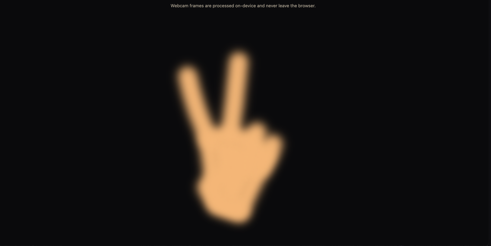
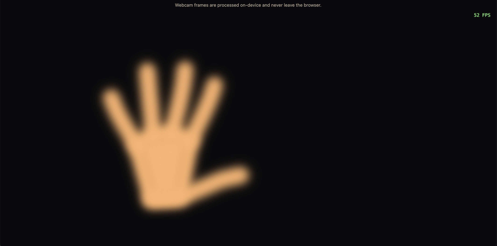
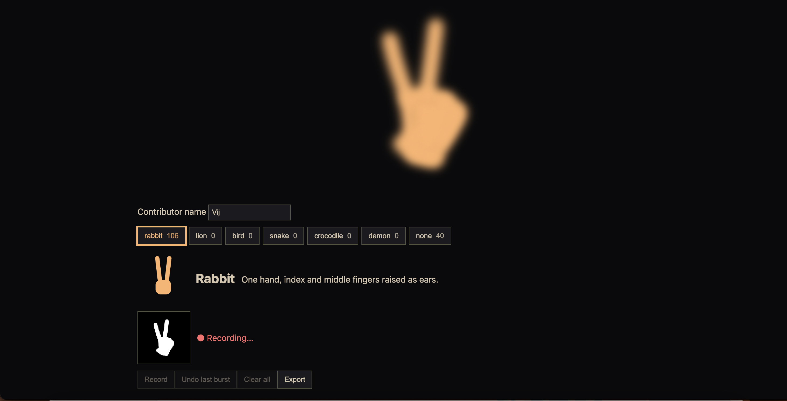
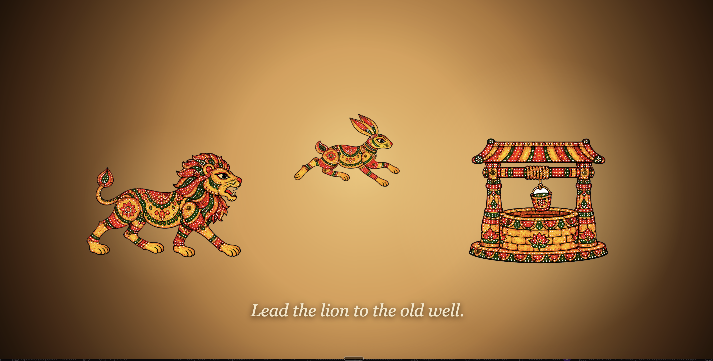

# Kiro Build Log

## Nov 5 – Setup
- Added 4 custom steering docs (product, tech, structure, cultural guidelines) with inclusion: always
- Added Context7 MCP so Kiro reads real MediaPipe / TF.js / PixiJS docs
- Why: keep every generation aligned with the vision and stop API hallucinations
## Nov 5 – Spec 1: vision-and-collection
- Started first spec from a structured prompt; Kiro generating requirements
- Kiro consulted Context7 for the real MediaPipe HandLandmarker API before writing the spec (driven by our tech.md rule: "never invent APIs")
- Tasks generated: 18 task groups, ordered with a dependency graph; property tests placed next to the code they validate
- Next: implement tasks 1.1 → 8.1, then preview page (16.1) to visually verify the shadow early

## Nov 7 – Spec 1 implementation (Day 2)

### Tasks 1.1–1.5: Scaffold + assets
- Kiro scaffolded Vite + TypeScript (strict), multi-page build (main app + collector)
- Added Vitest + fast-check
- Asset setup script on npm postinstall: copies MediaPipe WASM to public/wasm and
  downloads hand_landmarker.task to public/models (served locally, no CDN)
- README documents the asset setup

### Tasks 2.1, 3.1: Config + shared types
- All tunables centralised in src/config.ts
- Shared types document the mirrored Display_Coordinate_Space contract

### Tasks 4.1–8.1: Vision pipeline
- Camera with permission / no-device error handling and on-device privacy notice
- HandLandmarker with GPU delegate and CPU fallback
- Per-frame pipeline: single timestamp per tick, single mirror (x' = 1 − x)
- Silhouette renderer: thick rounded finger strokes + palm polygon, scale-relative
  thickness, offscreen downscaled blur
- FPS overlay toggled with D

### Task 16.1: Preview page (early visual checkpoint)
- Ran the preview before building the collector to catch visual issues early
- Bug: black screen. Console proved tracking worked, so the fault was in rendering.
  Asked Kiro to debug the render path and add an L-key landmark debug overlay → fixed
- Checkpoint passed: mirroring correct, distinct fingers (rabbit ears separate), 42–52 FPS

### Tasks 9.1–9.3: Feature extractor + property-based tests
- Feature extractor: fixed hand slots, aspect-corrected normalization, inter-hand features
- 10 fast-check properties (100 runs each), all passing
- Property 2 generator deliberately includes identical-wrist-x and identical-x+y pairs
  to exercise the tiebreaker
- Strict TypeScript: zero errors

### Next (Nov 8)
- Tasks 11.1 → 15.1: mask generator, sample store, exporter, capture controller, collector page

## Nov 8 – Spec 1 implementation (Day 3) – collector complete

### Tasks 11.1–11.2: Mask generator + Property 11
- 96×96 single-channel shadow mask (0 = background, 255 = shadow), raw uint8 → base64
- Reuses the SAME SilhouetteRenderer as the preview, rendered white-on-black, so the CNN
  trains on exactly the geometry users see (no duplicated drawing code)
- Crops to the hands' bounding box + padding scaled to hand size, centred, aspect preserved; no hands → blank mask
- Review caught gaps the green tests hid; sent back to Kiro:
  - Property 11 was testing helpers inside the test file → moved into production
    `encodeMask` / `decodeMask`, which the exporter now reuses
  - Added edge masks (all-0, all-255, single lit pixel at index 0 and 9215)
  - Padding now covers the silhouette's half stroke width (0.125 × hand scale) so fingertips never clip
  - New assertion: non-null crop ⇒ non-empty mask, plus an asymmetric-hand example, so a double-mirror bug fails loudly
  - `maskBlurRadius: 0` → crisp training masks; preview keeps its warm blur
- Lesson: a passing property is only as good as the code it actually calls

### Task 12.1: Sample store
- IndexedDB persistence; undo removes the latest-timestamp burst; clear-all asks for confirmation

### Tasks 13.1–13.2: Exporter + Property 12
- Versioned JSON export with metadata; uses the shared mask codec
- Export round-trip property passing

### Task 14.1: Capture controller
- Fixed 4 s bursts at 10 samples/sec (40 per burst), tagged with sessionId + burstId
- Recording disabled until the tracker is ready

### Task 15.1: Collector page
- Contributor name (required), 7-label picker with live counts, reference illustration + hint per shape
- Live 96×96 mask thumbnail, Record / Undo last burst / Clear all / Export

### Task 18: Final checkpoint
- `tsc --noEmit` clean · 12/12 correctness properties passing (100 runs each)
- Live test passed: name gate, thumbnail centred with fingertips intact, correct mirroring,
  mask size stable at any distance, two hands combine, 40 samples/burst, `none` records
  without hands, undo removes only the last burst, data survives reload, export has all
  fields, clear-all confirms, no console errors

### Other
- Requested the 4,000 Kiro credits via the Devpost Resources form
- Considering Frankenstein as the primary category (ancient craft stitched to ML)

### Next (Nov 9–10)
- Recording sessions with 3–5 people, 250+ samples per label; export after each session
- Optional: PBT mutation check (break the slot tiebreaker, screenshot fast-check catching it)
- Spec 2: `classifier`

## Nov 9 – Spec 1 fully tested + Spec 2 drafted (Day 4)

### Tasks 1.2, 1.3: Housekeeping
- Multi-page build and Vitest + fast-check were already in place but unticked
- Kiro verified the existing work and checked both off

### Task 14.2: Capture rate test
- Simulates bursts at different frame rates
- Accumulator emits ~10 samples/sec → 40 per 4 s burst, independent of FPS
- Done before recording day so the dataset maths (bursts × 40) is guaranteed

### Task 12.2: Undo after reload
- `fake-indexeddb` simulates a page reload with empty in-memory state
- Undo deletes exactly the latest-timestamp burst; samples and counts restore on load
- Contributors will rely on undo and persistence during recording, so this was tested first

### Tasks 6.2, 7.2: Single-mirroring tests
- Pipeline mirrors once (x' = 1 − x): mirrored x = 0.2 lands on the left of the preview
- Emitted timestamp matches the one passed to detect
- Renderer applies no extra canvas flip
- Locks in the mirroring contract before the classifier depends on it

### Tasks 4.2, 5.2: Startup paths
- Camera: granted / denied / no-device each surface the right message
- HandLandmarker: GPU first → CPU fallback → clear error if both fail

### Task 17.1: Integration + perf smoke
- End-to-end checks across capture → persist → export
- 30 fps performance note alongside the FPS overlay

### Strict mode kept the tests honest
- `noUncheckedIndexedAccess` flagged unsafe array indexing in new tests (7 errors)
- Fixed with explicit throwing guards and `?? 0`, never `!` or a looser tsconfig
- A missing offscreen canvas now fails with a clear message instead of a crash
- Spec 1: every task done, including all optional tests

### Spec 2: classifier – drafted
- Prompt covered 12 requirements: shared code moved into `src/vision/`, dataset loading and validation,
  leak-free split (hold out whole contributors), landmark MLP vs silhouette CNN, ≥90% held-out target,
  TF.js export, debounced live predictor, C-key debug view
- Training in TypeScript on Node, reusing the exact production feature code (no train/serve skew)
- Kiro generated requirements (EARS), design (21 correctness properties) and tasks (14 groups)
- Kiro checked TF.js APIs with Context7 and ran small local tests before designing:
  - tfjs-node fails on Node 26 → training probes backends and falls back to wasm → cpu
  - `restoreBestWeights` unsupported and `fit` shuffle unseedable → own seeded epoch loop
  - `.gitignore` ignored all of public/models/ → classifier folder un-ignored
- Review flagged fixes before implementation: stable contributor IDs, required export round-trip test,
  seeded weight initialisers
- Kiro generated all three stages in one go; from Spec 3 on, the prompt stops after requirements for review

### Other
- Best Student Project is awarded per category (4 prizes), so it isn't tied to Costume Contest.
  Frankenstein stays open
- Bonus prizes to check: Best Ghost of Kiroween Past, Best Demo
- Puppet art plan: ChatGPT-generated webps as separate jointed parts in one consistent style, credited in the write-up

### Next (Nov 10)
- Recording sessions with 3–5 people, 250+ samples per label; export after each session
- Send the Spec 2 revision prompt, review tasks.md, start task 1.1

### Task 1.6: `loadLayersModel` with fake `fetchFunc` in Node
- Outcome: **works**. `tf.loadLayersModel('http://localhost/models/classifier/model.json', { fetchFunc })` loads a model served from a temp dir via a fake fetch (global `Response`) on the CPU backend
- Predictions match the in-memory model (5 decimals); `weights.bin` is requested under `/models/classifier/`, so the HTTP path-resolution step is exercised
- Task 8.5 fallback (`tf.io.fromMemory`) is not needed
- Test: `training/export.fetch-loader.test.ts`; passes, and `npm run typecheck` is clean

## Nov 12–13 – Spec 2 finalised, group 1 built, first playable scene (Day 5)

### Spec 2: classifier – revisions
- Stable contributor IDs: append-only registry (data/contributors.json, gitignored), names trimmed and
  matched case-insensitively; test contributors chosen by ID in training-config.ts
- Export round-trip test made required: custom writer (tf.io.withSaveHandler) → tf.loadLayersModel → same predictions
- All initialisers seeded; dropout deliberately left unseeded (the one source of run-to-run variation)
- Hygiene test also asserts /.kiro is never ignored (ignoring it would disqualify the entry)
- Pointing and a relaxed open hand count as `none` (they'll be the puppeteering poses)
- Kiro's subagent verified behaviour in a throwaway repo and the tfjs-core source instead of guessing.
  Slow, but no surprises later

### Group 1: relocation, deps, gitignore
- FeatureExtractor moved into src/vision/ as a 100% rename (no logic change); MaskGenerator only had import paths updated
- public/models/classifier/ un-ignored; data/raw/, contributors.json, training/out/ ignored
- Fake-fetch model loading confirmed working in Node
- 70/70 tests passing, tsc clean

### Spike: first playable scene (vibe-coded, branch spike/puppet-follow)
- Rabbit follows the index fingertip on a warm, flickering lamp-lit cloth screen (P key)
- "The Clever Rabbit and the Lion" (S key): lion appears → rabbit appears → hold hand steady to awaken →
  point to lead the rabbit to the well → lion bounds over, sees its reflection, roars, leaps in → R to replay
- Puppet art: ChatGPT-generated Tholu Bommalata-style images; white backgrounds removed with an edge
  flood fill so the perforation dots stay
- Multiply blending looked beautiful alone but turned overlaps muddy → switched to alpha cutouts + warm glow
- Web Audio sound effects (chimes, roar, splash, lamp crackle); Web Speech narration was silent → dropped for now
- Fixed 16:9 world that scales down on narrow screens, so nothing spills off or scrolls
- Lesson: vibe coding got a feel-it-now demo in one evening, but it's one untested file. The real
  version gets rebuilt through specs, with this spike as the reference

### Design decisions
- Category: **Resurrection** (reviving a dying 2,000-year-old projection art). Targets: Best Resurrection,
  Best Student Project, Best Demo, Bonus Blog, Social Blitz
- Interaction: cast a shape once to summon → relax and point; the puppet follows the index fingertip
- Puppet library: shadow-cast (rabbit, lion, bird, snake, crocodile, demon) + stock puppets summoned by a
  steady hand (man, woman, king, queen, farmer, boy, girl, monkey, elephant, deer)
- Stretch, Spec 7 "Weave Your Own Tale": choose up to 3 characters → write a short story → a text LLM turns it
  into a screenplay in the same format as the hand-written tales → validated, then performed

### Other
- Received the 4,000 Kiro credits

### Next
- Record my own data (14 bursts), then others
- Spec 2 groups 2–3: shared helpers + debounce with property tests